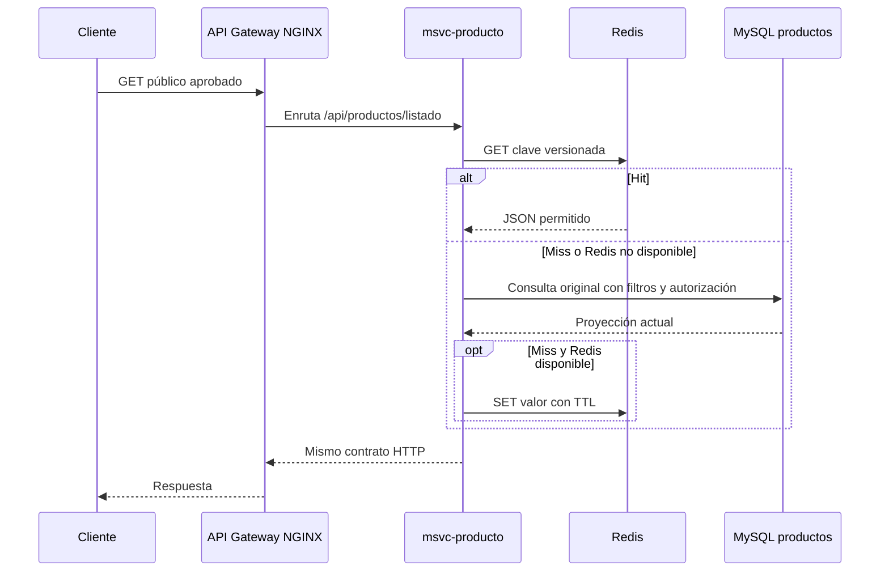

# A16 modelo de datos y claves de Redis

> **Estado:** diseño documental A16; no crea claves ni modifica backend, dependencias, Compose o base de datos.
> **Base técnica revisada:** `integration/estabilizacion-produccion` en `aca30ab648f968651d773d7bfb778f29c9002950` (2026-11-10). A11–A14 están integradas.
> **Rama documental actual:** `feature/a15-a18-redis-gateway` fue creada desde `integration/estabilizacion-produccion@aca30ab` para conservar A15/A16. A17 deberá salir desde el release desplegado según D-06.
> **Secuencia A17:** según D-06, crear una rama nueva desde el release desplegado después de completar la estabilización y la línea base. Las pruebas del piloto usarán datos sintéticos locales.

## Decisión de modelado

El objeto cacheado debe ser una **proyección de lectura estable y permitida**, no una entidad JPA ni un DTO anidado sin revisar. Para el piloto, cada valor se serializará en JSON con una versión de contrato incluida en el namespace de clave. MySQL sigue siendo el origen; ante fallo de Redis, el microservicio consulta MySQL.

A11–A14 ya están integradas. Sus rutas permiten ubicar el trayecto HTTP, pero no aprueban por sí solas la visibilidad de cada campo ni cierran los hallazgos de seguridad que siguen en D-06. La ruta, autorización y proyección se congelarán después de las tareas de seguridad y catálogo del release.

## Hallazgo del Gateway y flujo actual

- NGINX enruta `/api/productos` a `msvc-producto`; la configuración no contiene `proxy_cache`. Redis se integraría dentro del microservicio Producto como Cache-Aside; no se configura caché en NGINX ni en el Gateway.
- `GET /api/productos/listado` consulta una proyección en la base de Productos y luego invoca `InventarioClient.obtenerCantidadesPorProductos(...)` en cada petición para llenar `inventarioCantidad`. La respuesta actual no es exclusivamente producto.
- La primera propuesta cachea solo campos de una proyección pública de producto. El stock se consulta en vivo y se combina después si el contrato final lo mantiene. A17 medirá el camino completo; si la llamada a Inventario domina el tiempo y no hay una mejora medible, se aplaza Redis.
- `ProductoListadoDto` incluye `empresaId` e `inventarioCantidad`. No cachear esa clase completa. El precio solo entra a una proyección pública cuando T12/A23 lo apruebe; la consulta de checkout seguirá leyendo precio y disponibilidad del origen.
- El healthcheck de `docker-compose.gateway.yml` solo confirma el `/health` estático de NGINX. No demuestra conexión del Gateway con Producto, MySQL ni Redis.

## Trazabilidad de orígenes y campos

| Lectura | Tabla/servicio fuente observado | Campos potenciales para una proyección pública | Campos a excluir por defecto | Requisito antes de cachear |
|---|---|---|---|---|
| Producto de catálogo | `productos`, enlazada por `categoria_id` y `empresa_id` a `categorias` y `empresas` | Proyección mínima por aprobar: `id`, `nombre`, `descripcion`, `imagen`; `precio` solo tras T12/A23; nombres de categoría/empresa solo si son campos públicos aprobados | `emprendedor_id`, `empresaId` si no hace falta en el contrato público, `inventarioCantidad`, DTO de inventario, campos de contacto y cualquier atributo privado | Filtrar producto y empresa visibles; aprobar campos y DTO; definir invalidación de categorías/empresas si sus nombres se incluyen; medir la llamada de stock separada |
| Categoría visible | `categorias` | `id`, `nombre`, `descripcion` si son visibles en catálogo | categorías inactivas y campos técnicos que no consuma el cliente | El registro A14 informa un 200 local; resolver T07 y aprobar el DTO/campos antes de incluirla |
| Empresa visible | `empresas` | Como máximo `id` y `nombre` público, u otros campos aprobados por el propietario | `ruc`, `email`, `telefono`, `direccion` salvo publicación deliberada y aprobada | Revisar la finalidad y visibilidad campo por campo; no tratar `EmpresaResponseDto` completo como público |
| Inventario | `inventarios` del servicio de inventario | Ninguno para el primer piloto | `cantidad`, ubicación y cualquier saldo no confirmado como público | Excluido hasta acordar semántica de stock, autorización y máximo de obsolescencia |
| Usuario, venta, sesión y administración | Bases de autenticación/ventas | Ninguno | JWT, contraseñas, perfil, ventas, pagos, carrito, respuestas administrativas | Excluidos del alcance A15–A18 inicial |

### Observaciones del código actual

- El esquema `productos` tiene campos de precio, imagen, categoría, empresa, emprendedor y estado activo. Una lectura pública debe filtrar correctamente registros inactivos y evitar exponer propietario interno.
- `ProductoListadoDto` contiene `empresaId` e `inventarioCantidad`; el servicio llena el segundo mediante una llamada a Inventario por cada solicitud. No cachear el DTO entero. La proyección pública requiere separar campos de producto y enriquecer stock en vivo, si sigue en el contrato.
- `ProductoResponseDto` contiene `emprendedorId`, `InventarioInfoDto` y un `EmpresaResponseDto` con atributos que la revisión H-15 no considera públicos por defecto; no usarlo como valor cacheado público.
- `CategoriaResponseDto` incluye activo y marcas de tiempo. A16 debe acordar si esos campos forman parte del contrato público cacheado.
- `EmpresaResponseDto` incluye RUC, teléfono, email y dirección; la lectura de empresas no debe cachearse completa por defecto.
- El esquema de inventario está en otro servicio. No se mezclará en la primera clave de catálogo hasta acordar cómo se actualiza y cuánto tiempo puede estar obsoleto.

## Rutas candidatas y estado

| Ruta | Estado observado en la integración | Decisión para A17 |
|---|---|---|
| `GET /api/productos/listado` | El Gateway la enruta a Producto y el registro A14 reporta un 200 local. Producto consulta MySQL y añade stock desde Inventario en cada llamada; el DTO contiene `empresaId` e `inventarioCantidad`. | **Única candidata**, condicionada a una proyección pública separada del stock, permisos y campos corregidos, precio público resuelto por T12/A23 y mejora medida. No cachear la respuesta actual completa. |
| `GET /api/productos` y `GET /api/productos/{id}` | Rutas de Producto; la respuesta puede contener relaciones anidadas de empresa e inventario. | No cachear hasta definir DTO público y resolver H-15. |
| `GET /api/productos/categoria/{categoriaId}` y `/empresa/{empresaId}` | Rutas existentes; la relación de empresa puede tener semántica pública o de propiedad. | Fuera del primer piloto hasta aprobación de autorización, proyección y alcance de clave. |
| `GET /api/categorias` | El registro A14 informa lectura local por Gateway. Eso no aprueba automáticamente campos ni escrituras relacionadas. | Alternativa futura solo tras T07 y definición de campos públicos; no es candidata inicial. |
| `GET /api/empresas` | Enrutada a Producto; contiene información de empresa que requiere clasificación. | No cachear DTO administrativo; reevaluar solo con DTO público aprobado. |
| `GET /api/inventarios/**` | Enrutada al microservicio Inventario. | Excluida: no cachear stock ni movimientos. |

La ruta del Gateway define el transporte, no la autorización ni la política de caché. El registro de A14 es una evidencia de pruebas locales informada por el repositorio, no una aprobación para usar datos reales ni un cierre del plan D-06.

## Claves propuestas

Las claves serán legibles, versionadas, sin tokens ni datos personales. Los filtros se canonicalizan (mismos parámetros producen la misma cadena) y se resumen con hash para no incluir filtros arbitrarios en texto claro.

```text
feriadigital:v1:catalogo:productos:listado:publico:g{generacion}
feriadigital:v1:categorias:publicas:g{generacion}
feriadigital:v1:empresas:visibles:g{generacion}:q:{hashConsulta}
feriadigital:v1:catalogo:empresa:{empresaId}:g{generacion}:q:{hashConsulta}
```

Reglas:

1. `v1` cambia cuando cambia el formato del valor cacheado o la semántica de filtros; las claves anteriores dejan de leerse.
2. El listado global sin parámetros puede usar una clave de scope `publico`. La clave con `empresaId` es solo un patrón futuro y se habilita únicamente si la ruta queda aprobada como pública; nunca convierte en pública una respuesta de panel.
3. Si una respuesta depende de usuario, rol o permiso, no usar una clave compartida pública. Ejecutar autorización antes de cualquier lookup.
4. El endpoint `/api/productos/listado` observado no declara parámetros de página/filtro. Si A19/A20 los agregan, incluir `page`, `size`, `sort` y filtros normalizados en la clave; no reutilizar una respuesta de otra consulta.
5. No poner JWT, email, nombre de usuario, contraseña o datos privados dentro de las claves.

## TTL inicial para decisión del equipo

Estos son valores conservadores propuestos para A17. A16 debe confirmarlos con el dueño del catálogo y la frecuencia de edición antes de implementarlos.

| Recurso | TTL propuesto | Razón | Invalidación que complementa el TTL |
|---|---:|---|---|
| Catálogo público de productos | 300 s (5 min) | Mantiene pequeña la ventana de precio/estado obsoleto | Crear, editar, activar/desactivar o eliminar producto; cambio de categoría/empresa visible |
| Categorías públicas | 900 s (15 min) | Normalmente cambian menos; una edición puede invalidar de inmediato | Crear, editar, activar/desactivar o eliminar categoría |
| Empresas visibles públicamente | 900 s (15 min) | Perfil público de baja frecuencia si los campos son aprobados | Cambiar nombre/estado/campos publicados o relación empresa-productos |
| Inventario y stock | Sin TTL porque queda fuera del piloto | Su frescura tiene efecto comercial y aún falta contrato de visibilidad | Requiere diseño específico y aceptación del dueño de inventario |

El TTL limita la vida de cada entrada a 5 minutos desde su última escritura en Redis, pero por sí solo no demuestra un máximo de 5 minutos de obsolescencia desde el commit en MySQL: una lectura que comenzó antes de ese commit podría intentar guardar su resultado después. El equipo debe aceptar la ventana real solo después de que A17 pruebe y cierre esa carrera; no renovar TTL al responder un hit. Si el máximo no queda acotado o no se acepta, ese recurso no entra al piloto hasta contar con invalidación durable.

## Invalidación propuesta

Para el piloto, usar un contador de generación por recurso y scope, evitando enumerar combinaciones de filtros/páginas. Las claves incluyen la generación actual. Después de confirmar una escritura en MySQL, el servicio propietario incrementa la generación relevante; las claves anteriores quedan huérfanas y vencen por TTL.

| Escritura confirmada | Generación a incrementar |
|---|---|
| Crear/editar/eliminar producto o cambiar estado, precio, imagen, categoría o empresa | Listado público y cualquier variante pública aprobada |
| Crear/editar/eliminar o activar/desactivar categoría | Categorías y listado de productos solo si su nombre/estado aparece en la proyección |
| Cambiar nombre, estado o campo publicado de empresa | Proyección de empresa y listado solo si sus datos aparecen en la proyección |
| Cambio de inventario | Ninguna en el piloto: inventario permanece en vivo y no se cachea |

Un fallo al incrementar la generación tras una escritura confirmada no revierte esa escritura ni garantiza un bypass global a MySQL; una entrada anterior podría servirse hasta que venza. La lectura concurrente iniciada antes del commit también puede intentar escribir un valor viejo después. A17 debe probar y prevenir o acotar ambos casos. El TTL no se renueva en un hit; el precio y el stock de checkout siempre se validan en el origen. Si el equipo no acepta la ventana demostrada, no habilitar el recurso hasta contar con invalidación durable.

La invalidación de categoría o empresa solo es necesaria si esos campos forman parte de la proyección cacheada. No ejecutar `FLUSHALL` ni `FLUSHDB`; no borrar todas las claves de Redis para actualizar un recurso.

## Flujo Cache-Aside



El lector debe recibir el mismo contrato en hit, miss o fallback. Redis no cambia el código HTTP ni omite autorización. NGINX solo enruta y aplica políticas perimetrales; no actúa como caché. A16 fija la serialización y la proyección pública final antes de A17.

## Referencias revisadas

- [Diseño A11 integrado](https://github.com/Vissjv12/TiendaVirtual-TrabajoTitulacion-equipo/blob/integration/estabilizacion-produccion/Documentos_Jordy/A11-ESTRATEGIA-Y-DISENO-GATEWAY.md), [Gateway NGINX](https://github.com/Vissjv12/TiendaVirtual-TrabajoTitulacion-equipo/blob/integration/estabilizacion-produccion/gateway/nginx.conf) y [Compose del Gateway](https://github.com/Vissjv12/TiendaVirtual-TrabajoTitulacion-equipo/blob/integration/estabilizacion-produccion/docker-compose.gateway.yml).
- [Registro A14](https://github.com/Vissjv12/TiendaVirtual-TrabajoTitulacion-equipo/blob/integration/estabilizacion-produccion/Documentos_Jordy/REGISTRO-ETAPA-4-GATEWAY-A11-A14.md) y [revisión de seguridad / tareas D-06](https://github.com/Vissjv12/TiendaVirtual-TrabajoTitulacion-equipo/blob/integration/estabilizacion-produccion/Documentos_Jordy/REVISION-FLUJO-SEGURIDAD-Y-TAREAS.md).
- [ProductoController](https://github.com/Vissjv12/TiendaVirtual-TrabajoTitulacion-equipo/blob/integration/estabilizacion-produccion/Microservicios/msvc-producto/src/main/java/com/example/msvc_producto/presentation/controller/ProductoController.java), [ProductoServiceImpl](https://github.com/Vissjv12/TiendaVirtual-TrabajoTitulacion-equipo/blob/integration/estabilizacion-produccion/Microservicios/msvc-producto/src/main/java/com/example/msvc_producto/application/service/ProductoServiceImpl.java), [ProductoRepositoryImpl](https://github.com/Vissjv12/TiendaVirtual-TrabajoTitulacion-equipo/blob/integration/estabilizacion-produccion/Microservicios/msvc-producto/src/main/java/com/example/msvc_producto/infrastructure/persistence/impl/ProductoRepositoryImpl.java), [ProductoListadoDto](https://github.com/Vissjv12/TiendaVirtual-TrabajoTitulacion-equipo/blob/integration/estabilizacion-produccion/Microservicios/msvc-producto/src/main/java/com/example/msvc_producto/application/dto/ProductoListadoDto.java) y [SecurityConfig](https://github.com/Vissjv12/TiendaVirtual-TrabajoTitulacion-equipo/blob/integration/estabilizacion-produccion/Microservicios/msvc-producto/src/main/java/com/example/msvc_producto/infrastructure/config/SecurityConfig.java).
- [Esquema `productos`, `categorias` y `empresas`](https://github.com/Vissjv12/TiendaVirtual-TrabajoTitulacion-equipo/blob/integration/estabilizacion-produccion/db-03-schema-productos.sql) y [esquema `inventarios`](https://github.com/Vissjv12/TiendaVirtual-TrabajoTitulacion-equipo/blob/integration/estabilizacion-produccion/db-04-schema-inventario.sql).
