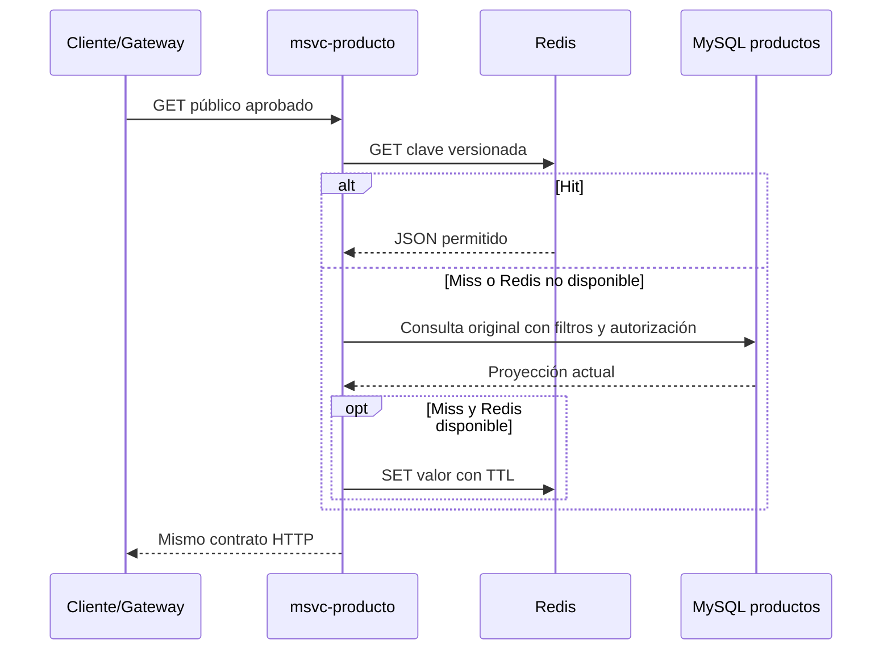

# A16 modelo de datos y claves de Redis

> **Estado:** borrador de diseño; rutas y DTOs observados en `integration/etapa5-redis` al 2026-11-08.
> **Alcance:** especificar qué respuestas podría guardar A17; no crear claves reales ni cambiar el backend.
> **Regla principal:** Redis guarda valores clave/valor derivados de lecturas aprobadas, no tablas MySQL completas.

## Decisión de modelado

El objeto cacheado debe ser una **proyección de lectura estable y permitida**, no una entidad JPA ni un DTO anidado sin revisar. Para el piloto, cada valor se serializará en JSON con una versión de contrato incluida en el namespace de clave. MySQL sigue siendo el origen; ante fallo de Redis, el microservicio consulta MySQL.

La ruta y el DTO definitivos se fijarán después de integrar A11–A14. La propuesta A11 dice que algunas lecturas de Producto/Categoría/Empresa son públicas, pero es un documento de diseño aún no integrado. La configuración de seguridad actual y los contratos reales deben verificarse de nuevo en A14.

## Trazabilidad de orígenes y campos

| Lectura | Tabla/servicio fuente observado | Campos potenciales para una proyección pública | Campos a excluir por defecto | Requisito antes de cachear |
|---|---|---|---|---|
| Producto de catálogo | `productos`, enlazada por `categoria_id` y `empresa_id` a `categorias` y `empresas` | `id`, `nombre`, `descripcion`, `precio` solo tras A23, `imagen`, nombre visible de categoría y empresa | `emprendedor_id`, `empresaId` si el cliente público no lo requiere, `inventarioCantidad`, DTO de inventario, identificadores/atributos privados | Verificar producto activo, empresa visible, precio público y respuesta exacta por Gateway |
| Categoría visible | `categorias` | `id`, `nombre`, `descripcion` si son visibles en catálogo | categorías inactivas y campos técnicos que no consuma el cliente | Confirmar que `GET /api/categorias` es lectura pública de acuerdo con A14 |
| Empresa visible | `empresas` | Como máximo `id` y `nombre` público, u otros campos aprobados por el propietario | `ruc`, `email`, `telefono`, `direccion` salvo publicación deliberada y aprobada | Revisar la finalidad y visibilidad campo por campo; no tratar `EmpresaResponseDto` completo como público |
| Inventario | `inventarios` del servicio de inventario | Ninguno para el primer piloto | `cantidad`, ubicación y cualquier saldo no confirmado como público | Excluido hasta acordar semántica de stock, autorización y máximo de obsolescencia |
| Usuario, venta, sesión y administración | Bases de autenticación/ventas | Ninguno | JWT, contraseñas, perfil, ventas, pagos, carrito, respuestas administrativas | Excluidos del alcance A15–A18 inicial |

### Observaciones del código actual

- El esquema `productos` tiene campos de precio, imagen, categoría, empresa, emprendedor y estado activo. Una lectura pública debe filtrar correctamente registros inactivos y evitar exponer propietario interno.
- `ProductoListadoDto` actualmente contiene `empresaId` e `inventarioCantidad`. No cachear esa clase directamente para público sin definir si esos dos campos se exponen y si stock está dentro del contrato público.
- `ProductoResponseDto` contiene `emprendedorId`, `InventarioInfoDto` y un `EmpresaResponseDto`. Este último incluye RUC y datos de contacto/dirección en el DTO actual; construir una proyección pública o elegir otra respuesta.
- `CategoriaResponseDto` incluye activo y marcas de tiempo. A16 debe acordar si esos campos forman parte del contrato público cacheado.
- `EmpresaResponseDto` incluye RUC, teléfono, email y dirección; la lectura de empresas no debe cachearse completa por defecto.
- El esquema de inventario está en otro servicio. No se mezclará en la primera clave de catálogo hasta acordar cómo se actualiza y cuánto tiempo puede estar obsoleto.

## Rutas candidatas y estado

| Candidata | Microservicio | Estado en la propuesta A11 | Estado que debe demostrarse |
|---|---|---|---|
| `GET /api/productos/listado` | Producto | Propuesta como lectura pública bajo `/api/productos` | Ruta de Gateway integrada; precio público resuelto por A23; proyección sin stock/propietario privados; filtros/orden claros |
| `GET /api/productos` y `GET /api/productos/{id}` | Producto | Propuestas como lecturas públicas | Igual que arriba; revisar tamaño, datos anidados, filtros y contrato |
| `GET /api/productos/categoria/{categoriaId}` | Producto | Propuesta como lectura pública | Incluir `categoriaId` en alcance/filtros de clave; validar autorización y contenido |
| `GET /api/productos/empresa/{empresaId}` | Producto | Propuesta como lectura pública | Clave con `empresaId`; confirmar si el resultado es realmente público o pertenece a panel privado de emprendedor |
| `GET /api/categorias` | Producto | Propuesta con lectura pública | A14 debe confirmar contrato y autorización efectiva |
| `GET /api/empresas` | Producto | Propuesta con lectura pública | Publicar solo campos autorizados; no reutilizar el DTO administrativo completo |
| `GET /api/inventarios/**` | Inventario | Propuesta A11 expone rutas de lectura | No candidata inicial; A14 debe aclarar la aparente publicidad y `Sí.docx` recomienda no cachear stock privado |

Las rutas anteriores son **candidatas del diseño A11**, no una autorización operativa ni una decisión final de caché.

## Claves propuestas

Las claves serán legibles, versionadas, sin tokens ni datos personales. Los filtros se canonicalizan (mismos parámetros producen la misma cadena) y se resumen con hash para no incluir filtros arbitrarios en texto claro.

```text
feriadigital:v1:catalogo:publico:g{generacion}:q:{hashConsulta}
feriadigital:v1:categorias:publicas:g{generacion}
feriadigital:v1:empresas:visibles:g{generacion}:q:{hashConsulta}
feriadigital:v1:catalogo:empresa:{empresaId}:g{generacion}:q:{hashConsulta}
```

Reglas:

1. `v1` cambia cuando cambia el formato del valor cacheado o la semántica de filtros; las claves anteriores dejan de leerse.
2. Una respuesta agregada y realmente pública puede usar el scope `publico`. Una respuesta de empresa específica incluye `empresaId`, aun si la lectura termina siendo pública.
3. Si una respuesta depende de usuario, rol o permiso, no usar una clave compartida pública. El primer piloto debe excluirla.
4. Si hay paginación, añadir `page`, `size`, `sort` y filtros al hash canónico. No cachear páginas hasta que A19/A20 definan su contrato, salvo aprobación expresa de un endpoint acotado no paginado.
5. No poner JWT, email, nombre de usuario, contraseña o datos privados dentro de las claves.

## TTL inicial para decisión del equipo

Estos son valores conservadores propuestos para A17. A16 debe confirmarlos con el dueño del catálogo y la frecuencia de edición antes de implementarlos.

| Recurso | TTL propuesto | Razón | Invalidación que complementa el TTL |
|---|---:|---|---|
| Catálogo público de productos | 300 s (5 min) | Mantiene pequeña la ventana de precio/estado obsoleto | Crear, editar, activar/desactivar o eliminar producto; cambio de categoría/empresa visible |
| Categorías públicas | 900 s (15 min) | Normalmente cambian menos; una edición puede invalidar de inmediato | Crear, editar, activar/desactivar o eliminar categoría |
| Empresas visibles públicamente | 900 s (15 min) | Perfil público de baja frecuencia si los campos son aprobados | Cambiar nombre/estado/campos publicados o relación empresa-productos |
| Inventario y stock | Sin TTL porque queda fuera del piloto | Su frescura tiene efecto comercial y aún falta contrato de visibilidad | Requiere diseño específico y aceptación del dueño de inventario |

El TTL limita la vida de cada entrada a 5 minutos desde su última escritura en Redis, pero por sí solo no demuestra un máximo de 5 minutos de obsolescencia desde el commit en MySQL: una lectura que comenzó antes de ese commit podría intentar guardar su resultado después. El equipo debe aceptar la ventana real solo después de que A17 pruebe y cierre esa carrera; no renovar TTL al responder un hit. Si el máximo no queda acotado o no se acepta, ese recurso no entra al piloto hasta contar con invalidación durable.

## Invalidación propuesta

Para el piloto con pocas consultas, usar un contador de generación por recurso y scope, evitando enumerar combinaciones de filtros/páginas. Las claves incluyen la generación actual. Después de confirmar una escritura en MySQL, el servicio propietario incrementa la generación relevante; las claves antiguas quedan huérfanas y vencen por TTL. Si el incremento falla, la escritura no se revierte ni Redis puede garantizar un bypass global: las lecturas de catálogo pueden servir el valor anterior mientras la clave viva. El TTL no se renueva en un hit. Una lectura concurrente iniciada antes del commit también podría intentar guardar después una respuesta antigua; A17 debe probar y prevenir o acotar esa carrera antes de declarar un límite de frescura. El precio definitivo y la disponibilidad antes de carrito/checkout/compra siempre deben validarse contra el origen. Si no se acepta la ventana probada o no se puede acotar, no habilitar ese recurso en A17 hasta diseñar invalidación durable.

| Escritura confirmada | Generación a incrementar |
|---|---|
| Crear/editar/eliminar producto o cambiar activo/precio/imagen/categoría/empresa | Catálogo público completo y catálogo por la empresa/categoría afectada, si existe ese scope |
| Crear/editar/eliminar o activar/desactivar categoría | Categorías y catálogo si el nombre/estado de categoría aparece en sus respuestas |
| Cambiar nombre, estado o campo publicado de empresa | Empresas visibles y catálogo de la empresa |
| Cambio de inventario | Ninguna en el piloto inicial; si se aprueba stock más adelante, invalidación propia luego del commit de inventario |

La invalidación ocurre después del commit en la fuente propietaria. Un fallo de Redis durante una lectura permite omitir caché y consultar MySQL; un fallo al incrementar la generación después de una escritura confirmada es distinto y no obliga a las demás instancias a omitir una clave vieja. No ejecutar `FLUSHALL` ni `FLUSHDB`; no borrar todas las claves de Redis para actualizar un recurso.

## Flujo Cache-Aside



El lector debe recibir el mismo contrato en hit, miss o fallback. Redis no cambia el código HTTP ni omite la autorización. A16 fija la serialización y la respuesta pública final antes de A17.

## Referencias revisadas

- [Esquema `productos`, `categorias` y `empresas`](https://github.com/Vissjv12/TiendaVirtual-TrabajoTitulacion-equipo/blob/integration/etapa5-redis/db-03-schema-productos.sql).
- [Esquema `inventarios`](https://github.com/Vissjv12/TiendaVirtual-TrabajoTitulacion-equipo/blob/integration/etapa5-redis/db-04-schema-inventario.sql).
- [ProductoController](https://github.com/Vissjv12/TiendaVirtual-TrabajoTitulacion-equipo/blob/integration/etapa5-redis/Microservicios/msvc-producto/src/main/java/com/example/msvc_producto/presentation/controller/ProductoController.java), [ProductoListadoDto](https://github.com/Vissjv12/TiendaVirtual-TrabajoTitulacion-equipo/blob/integration/etapa5-redis/Microservicios/msvc-producto/src/main/java/com/example/msvc_producto/application/dto/ProductoListadoDto.java) y [ProductoResponseDto](https://github.com/Vissjv12/TiendaVirtual-TrabajoTitulacion-equipo/blob/integration/etapa5-redis/Microservicios/msvc-producto/src/main/java/com/example/msvc_producto/application/dto/ProductoResponseDto.java).
- [Gateway A11 (diseño no integrado)](https://github.com/Vissjv12/TiendaVirtual-TrabajoTitulacion-equipo/blob/feature/a11-diseno-gateway/Documentos_Jordy/A11-ESTRATEGIA-Y-DISENO-GATEWAY.md).
