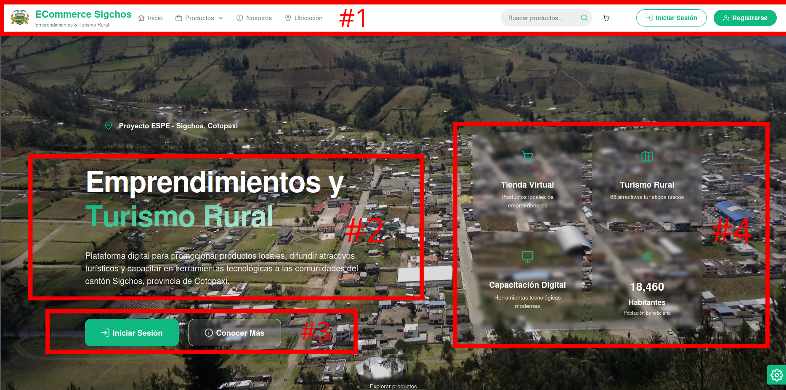
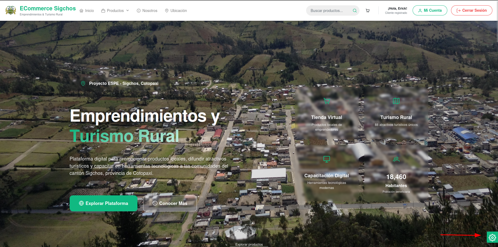
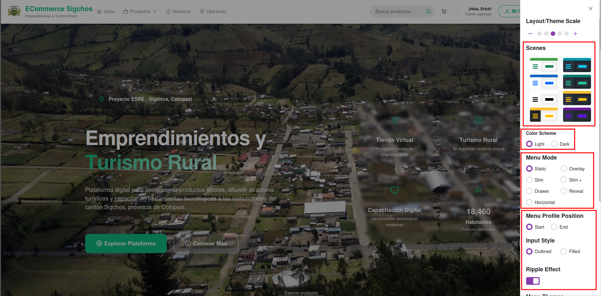
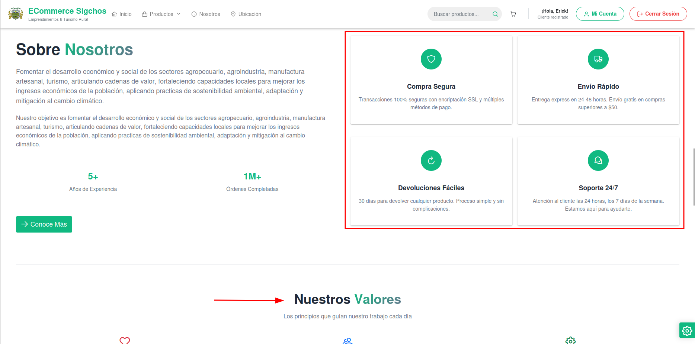
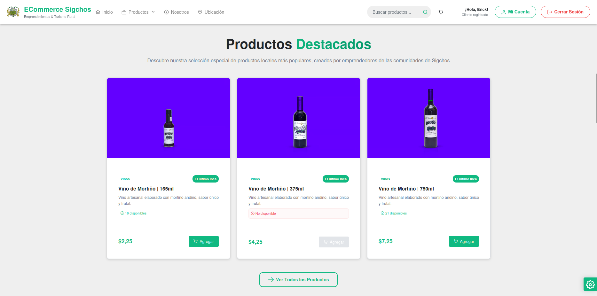
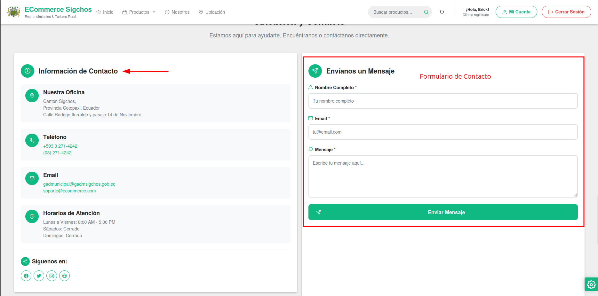
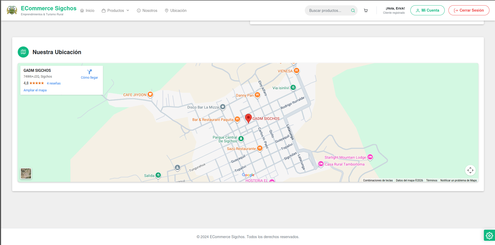

# Pantalla principal y navegación

## Vista general

La pantalla principal es la primera vista que aparece al ingresar al Sistema Sigchos E-Commerce. Desde esta pantalla el usuario puede conocer la plataforma, acceder al catálogo de productos, iniciar sesión, registrarse y consultar información sobre el proyecto.

En la @fig-vistageneral se identifican las opciones principales disponibles:

{#fig-vistageneral}

### Elementos principales de la pantalla

1. **Encabezado y logotipo**  
   En la parte superior se encuentra el logotipo y el nombre de la plataforma. También se muestran las opciones de navegación:

   - **Inicio**: permite regresar a la pantalla principal.
   - **Productos**: dirige al catálogo de productos disponibles.
   - **Nosotros**: muestra información general sobre el proyecto.
   - **Ubicación**: permite consultar los datos de contacto y la ubicación.
   - **Buscar productos**: permite localizar rápidamente un producto.
   - **Carrito**: permite revisar los productos seleccionados para la compra.
   - **Iniciar Sesión** y **Registrarse**: permiten acceder a una cuenta existente o crear una nueva.

2. **Información del proyecto**  
   El mensaje principal **“Emprendimientos y Turismo Rural”** presenta la finalidad de la plataforma: apoyar la promoción de productos locales, difundir los atractivos turísticos y acercar herramientas digitales a las comunidades del cantón Sigchos.

3. **Accesos rápidos**  
   - **Iniciar Sesión**: abre el formulario para ingresar con una cuenta registrada.
   - **Conocer Más**: dirige a información adicional sobre el proyecto y sus servicios.

4. **Secciones destacadas**  
   Las tarjetas ubicadas en el lado derecho muestran las principales áreas relacionadas con el proyecto:

   - **Tienda Virtual**: productos ofrecidos por los emprendimientos locales.
   - **Turismo Rural**: información sobre atractivos turísticos de la zona.
   - **Capacitación Digital**: apoyo y herramientas para fortalecer los conocimientos tecnológicos.
   - **Población Beneficiaria**: información sobre las personas a quienes beneficia el proyecto.

### ¿Qué puede hacer el usuario desde esta pantalla?

Desde la pantalla principal el usuario puede:

- Consultar las diferentes secciones de la plataforma.
- Buscar productos sin ingresar primero al catálogo.
- Acceder al carrito de compras.
- Crear una cuenta o iniciar sesión.
- Conocer información sobre el proyecto y sus servicios.

## Personalización de la apariencia

El sistema cuenta con un menú de configuración que permite adaptar algunos elementos visuales de la plataforma según las preferencias del usuario. Para abrirlo, se debe seleccionar el ícono de configuración ubicado en la esquina inferior derecha de la pantalla.

En la @fig-temas-icon se muestra el acceso al menú de personalización.

\begin{importantbox}[Personalización]
La personalización modifica únicamente la apariencia de la plataforma en el dispositivo del usuario. No cambia los productos, la cuenta ni la información de las compras.
\end{importantbox}

{#fig-temas-icon}

### Opciones disponibles

El panel permite seleccionar diferentes preferencias visuales, entre ellas:

- Diferentes combinaciones de colores para la interfaz.
- Modo claro o modo oscuro.
- Tamaño general de los elementos de la pantalla.
- Diferentes estilos de menú y presentación.

Para aplicar una opción, el usuario debe seleccionar la alternativa que prefiera dentro del panel. Los cambios se reflejan en la interfaz de la plataforma.

En la @fig-temas-panel se ilustra el panel completo de opciones de personalización:

{#fig-temas-panel}

## Sección “Sobre Nosotros”

La sección **Sobre Nosotros** presenta información sobre el propósito del Sistema Sigchos E-Commerce, su aporte a los emprendimientos locales y los principios que orientan su funcionamiento.

Esta sección permite:

- Conocer la finalidad del proyecto.
- Comprender cómo la plataforma apoya a los emprendimientos del cantón Sigchos.
- Revisar información sobre la seguridad de las compras.
- Conocer las condiciones de envío y devoluciones.
- Consultar las opciones de soporte disponibles.
- Identificar los valores que guían el trabajo de la plataforma.

\begin{infobox}[Información del proyecto]
La sección Sobre Nosotros permite conocer mejor el propósito de la plataforma y los servicios que ofrece a sus usuarios.
\end{infobox}

En la @fig-sobrenosotros se muestra el aspecto visual de la sección informativa:

{#fig-sobrenosotros}

## Productos destacados

La pantalla principal incluye una selección de productos destacados. Esta sección permite al usuario conocer algunos productos locales sin tener que revisar todo el catálogo.

Cada tarjeta muestra información básica del producto, como:

- Nombre del producto.
- Categoría.
- Empresa o emprendimiento que lo ofrece.
- Descripción breve.
- Precio.
- Disponibilidad.

Cuando el producto tiene existencias, el usuario puede seleccionar **Agregar** para incorporarlo directamente al carrito de compras. Si el producto no está disponible, el botón de compra aparecerá deshabilitado.

Como se observa en la @fig-productosdestacados, se detallan las tarjetas de los productos en la vista principal:

{#fig-productosdestacados}

## Ubicación y contacto

La sección de ubicación y contacto permite consultar la información del GAD Municipal del Cantón Sigchos y comunicarse con el equipo responsable de la plataforma.

El usuario puede encontrar:

- Dirección de la oficina.
- Números telefónicos.
- Correos electrónicos de contacto.
- Horarios de atención.
- Enlaces a redes sociales.
- Formulario para enviar un mensaje.

Para utilizar el formulario de contacto, el usuario debe ingresar su nombre completo, correo electrónico y mensaje. Luego debe seleccionar **Enviar Mensaje**.

En la @fig-ubicacion se muestra la información de contacto y el formulario:

{#fig-ubicacion}

## Nuestra ubicación

La opción **Nuestra Ubicación** muestra en un mapa interactivo la ubicación del GAD Municipal del Cantón Sigchos.

El mapa permite consultar visualmente la zona y utilizar las opciones disponibles para acercar, alejar o desplazarse por el mapa. Esta información puede ser útil para quienes necesiten visitar las oficinas o identificar el lugar de atención.

En la @fig-mapa se muestra el mapa integrado en la plataforma:

{#fig-mapa}

