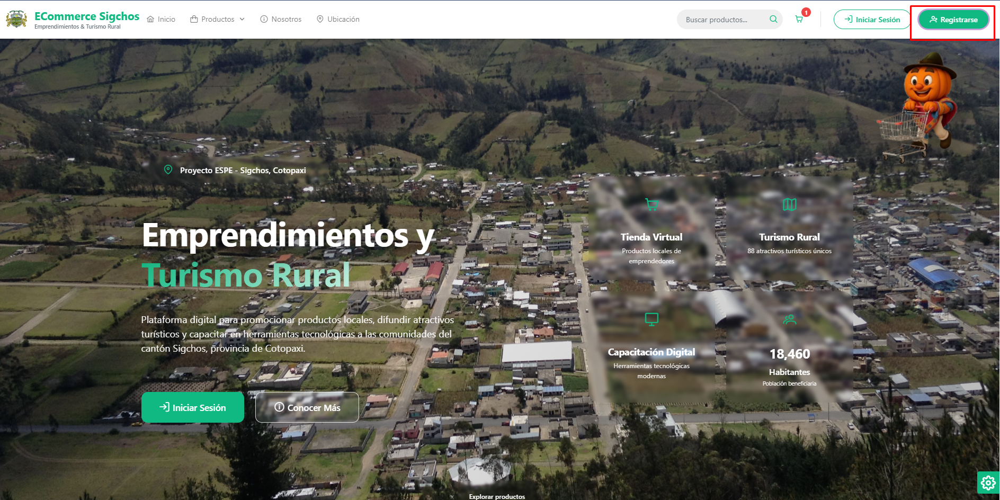
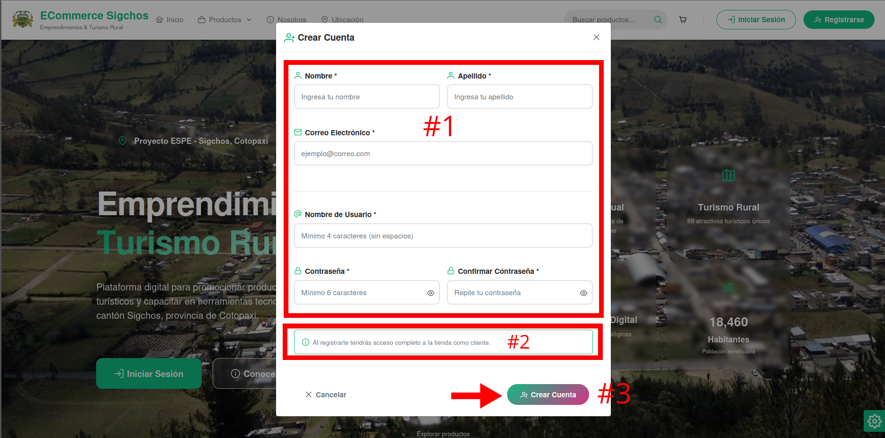
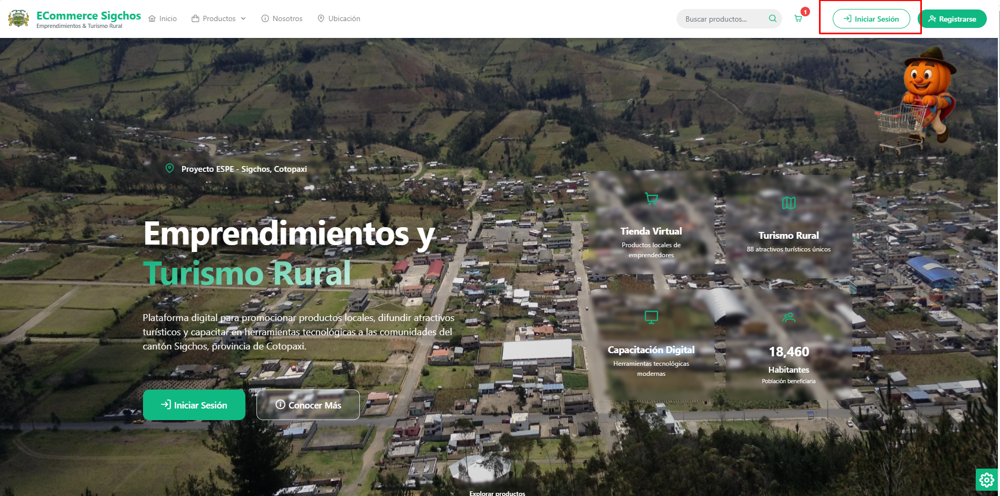
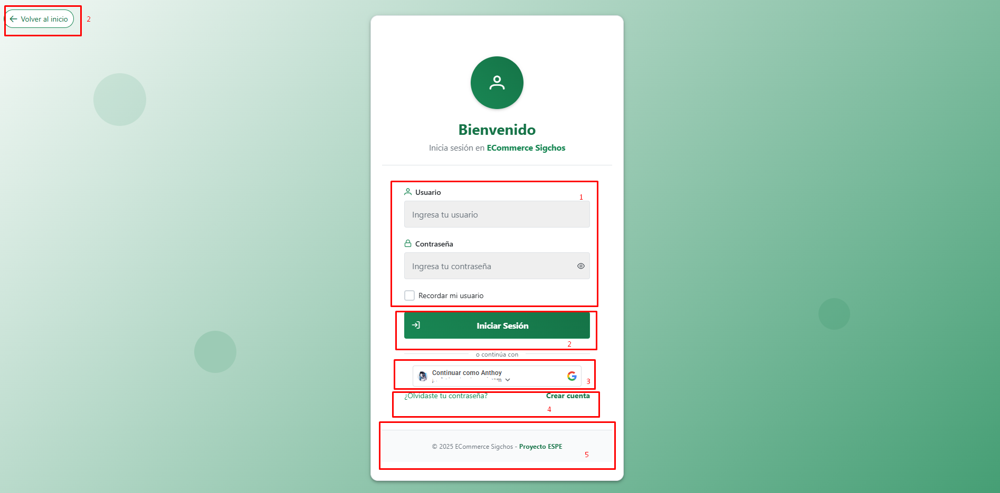
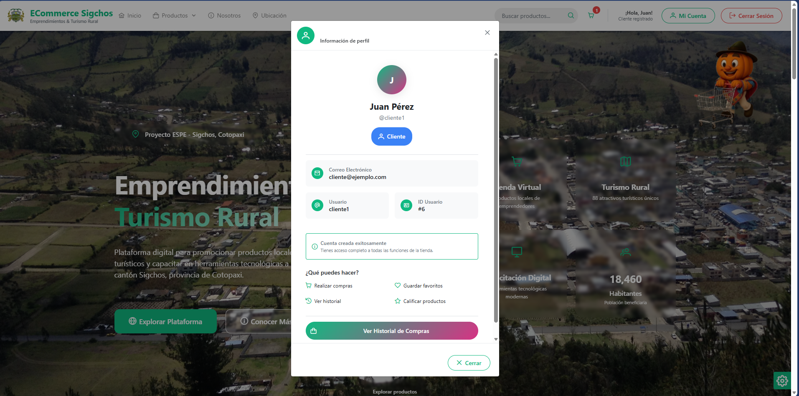

# Gestión de cuenta: registro e inicio de sesión

## Creación de cuenta

Permite a los nuevos usuarios registrarse en el Sistema Sigchos E-Commerce para acceder a las funciones disponibles para clientes, como consultar productos, realizar compras y gestionar pedidos.

Para ingresar al formulario de registro, desde la pantalla principal se debe seleccionar el botón **Registrarse**, ubicado en la parte superior derecha de la pantalla. La @fig-boton-registro muestra la ubicación de este botón:

{#fig-boton-registro}

Después de seleccionar **Registrarse**, se abrirá el formulario de creación de cuenta.

1. **Campos del formulario de registro**  
   - **Información personal**:
     - **Nombre ***: Campo obligatorio para el primer nombre (ejemplo: "Erick")
     - **Apellido ***: Campo obligatorio para el apellido (ejemplo: "Moreira")
     - **Correo Electrónico ***: Campo para email (ejemplo: "erickmoreira@gmail.com")

   - **Credenciales de acceso**:
     - **Nombre de Usuario***: Campo para elegir un nombre de usuario único
     - **Contraseña ***: Campo para establecer una contraseña segura 
     - **Confirmar Contraseña ***: Campo para verificar la contraseña ingresada

2. **Nota informativa**  
    - **Texto**: "Al registrarse, usted tendrá acceso completo a la tienda como cliente"

3. **Botón de acción**  
   - **"Crear Cuenta"**: Botón para enviar el formulario y completar el registro.

\begin{infobox}[Registro]
Es fundamental utilizar un correo electrónico válido para recibir notificaciones sobre el estado de sus pedidos.
\end{infobox}

En la @fig-creacioncuenta se observa el formulario de registro con los campos obligatorios marcados con asteriscos:

{#fig-creacioncuenta}

## Inicio de sesión

Permite a los usuarios registrados acceder a su cuenta personal en el Sistema Sigchos E-Commerce para gestionar compras, consultar pedidos, calificar productos, ver el historial y guardar favoritos.

Para ingresar al formulario de inicio de sesión, desde la pantalla principal se debe seleccionar el botón **Iniciar Sesión**. La @fig-boton-inicio-sesion muestra la ubicación del botón:

{#fig-boton-inicio-sesion}

Una vez seleccionado el botón, se mostrará la pantalla de acceso.

1. **Formulario de inicio de sesión**

   - **Campo “Usuario”**: permite ingresar el nombre de usuario registrado.
   - **Campo “Contraseña”**: permite ingresar la contraseña asociada a la cuenta. Por seguridad, los caracteres se muestran ocultos.

2. **Botones de acción principal**

   - **Recordar mi usuario**: permite guardar el nombre de usuario en el dispositivo para no tener que escribirlo nuevamente en futuros accesos. Esta opción debe utilizarse únicamente en dispositivos personales o de confianza.
   - **Iniciar Sesión**: envía los datos ingresados y permite acceder a la cuenta cuando las credenciales son correctas.
   - **Volver al Inicio**: regresa a la pantalla principal sin iniciar sesión.

3. **Inicio de sesión con Google**

   Si el usuario tiene una cuenta de Gmail, puede utilizar la opción de acceso con Google. Para hacerlo:

   - Seleccione la opción **Continuar como** o el botón de Google que aparece debajo del botón **Iniciar Sesión**.
   - Seleccione la cuenta de Gmail que desea utilizar.
   - Si Google solicita autorización, revise la información y permita continuar.
   - Al finalizar, el sistema validará la cuenta y dirigirá al usuario a la plataforma con su sesión iniciada.

   Esta opción permite ingresar sin escribir manualmente el usuario y la contraseña del sistema. El correo utilizado debe corresponder a la cuenta de Google que el usuario desea asociar con su acceso.

4. **Enlaces de recuperación y registro**

   - **¿Olvidaste tu contraseña?**: permite iniciar el proceso para recuperar o restablecer la contraseña.
   - **Crear cuenta**: dirige a los nuevos usuarios al formulario de registro.

5. **Pie de página institucional**

   - **“© 2026 ECommerce Sigchos - Proyecto ESPE”**: muestra la información institucional y los derechos de autor del sistema.

\begin{importantbox}[Seguridad]
Nunca comparta su contraseña con terceros. El sistema cifra automáticamente sus credenciales para proteger su privacidad.
\end{importantbox}

Como se observa en la @fig-iniciodesesion, la pantalla de acceso reúne el formulario tradicional, la opción de recordar el usuario, el acceso con Google y los enlaces de ayuda:

{#fig-iniciodesesion}

## Mi cuenta

Una vez iniciada la sesión, en la pantalla principal se activa el botón **Mi Cuenta**. Al seleccionarlo, el usuario puede consultar información de su perfil, como el correo electrónico, el nombre de usuario, el ID de usuario y las funcionalidades disponibles.

En la @fig-micuenta se observa el panel de información del usuario:

{#fig-micuenta}

