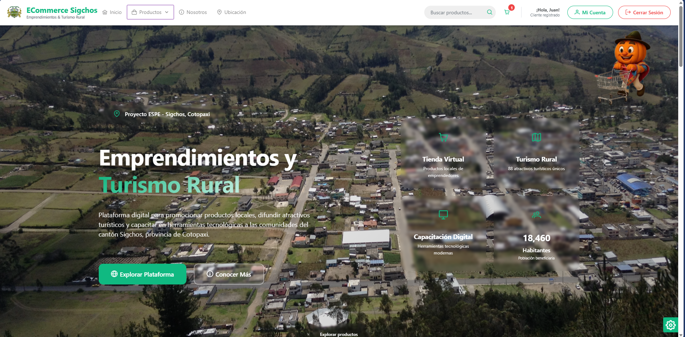
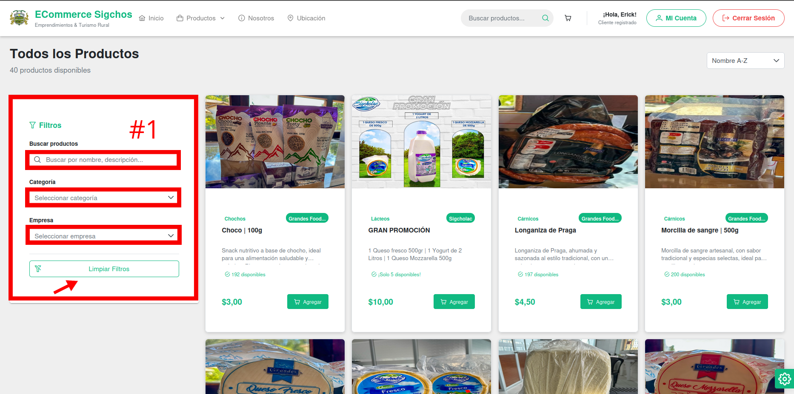
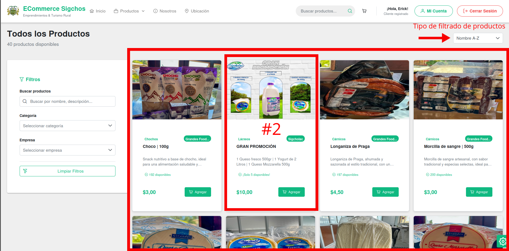
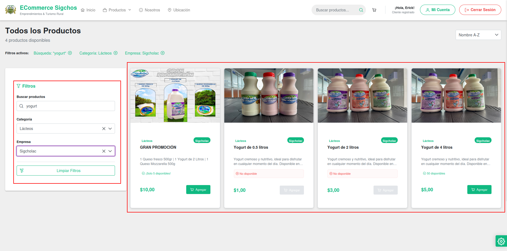

# Consulta de productos

## Todos los productos

Para ingresar al catálogo, desde la pantalla principal se debe seleccionar la opción **Productos** ubicada en la barra de navegación. La @fig-boton-productos muestra el botón de acceso:

{#fig-boton-productos}

Al seleccionar esta opción se abrirá la pantalla con todos los productos disponibles en el Sistema Sigchos E-Commerce. En esta sección el usuario puede consultar los productos, utilizar filtros y seleccionar los artículos que desea agregar al carrito.

La pantalla está dividida en dos áreas principales: el panel de filtros y el área de visualización de productos.

1. **Área de filtros (lado izquierdo)**
   - **Buscar por nombre o descripción**: permite ingresar una palabra o frase para localizar productos relacionados.
   - **Seleccionar categoría**: permite mostrar únicamente los productos de una categoría determinada.
   - **Seleccionar empresa**: permite filtrar los productos según el emprendimiento o empresa que los ofrece.
   - **Limpiar filtros**: elimina los criterios seleccionados y muestra nuevamente el catálogo completo.

\begin{infobox}[Navegación]
Los filtros permiten encontrar productos específicos de manera más rápida, especialmente cuando el catálogo contiene muchos artículos.
\end{infobox}

Como se observa en la @fig-filtros-izq, el panel de filtros se ubica en el lateral izquierdo para facilitar el acceso:

{#fig-filtros-izq}

2. **Área de productos (lado derecho)**

   Los productos se muestran en tarjetas que incluyen:

   - Imagen del producto.
   - Nombre del producto.
   - Descripción breve o características principales.
   - Categoría y empresa que lo ofrece.
   - Precio.
   - Cantidad disponible.
   - Botón **Agregar** para añadirlo al carrito.

En la parte superior derecha se encuentra un menú desplegable para ordenar los productos por:

   - Nombre, de A a Z.
   - Nombre, de Z a A.
   - Precio de menor a mayor.
   - Precio de mayor a menor.

\begin{importantbox}[Disponibilidad]
La disponibilidad se muestra en cada tarjeta. Si un producto no tiene existencias, el sistema lo identifica como no disponible y desactiva el botón para agregarlo al carrito.
\end{importantbox}

En la @fig-productos-grid se observa la disposición de los productos y las opciones de ordenamiento:

{#fig-productos-grid}

## Filtrado y búsqueda

El usuario puede combinar la búsqueda por texto con los filtros de categoría y empresa. Por ejemplo, puede escribir “yogurt”, seleccionar la categoría **Lácteos** y elegir una empresa para mostrar únicamente los productos que cumplen con esos criterios.

En la @fig-busqueda-ejemplo se observa un ejemplo de búsqueda y filtrado:

{#fig-busqueda-ejemplo}

