# Carrito y proceso de compra

## Agregar producto al carrito

Para comprar un producto es necesario iniciar sesión en el sistema. Los usuarios que no hayan iniciado sesión podrán consultar el catálogo, pero deberán ingresar a su cuenta antes de agregar productos al carrito o continuar con la compra.

Después de iniciar sesión, el usuario debe localizar el producto que desea adquirir y seleccionar el botón **Agregar**. El sistema mostrará una confirmación visual indicando que el producto fue añadido correctamente al carrito.

En la @fig-agregar-carrito se observa la confirmación después de agregar un producto:

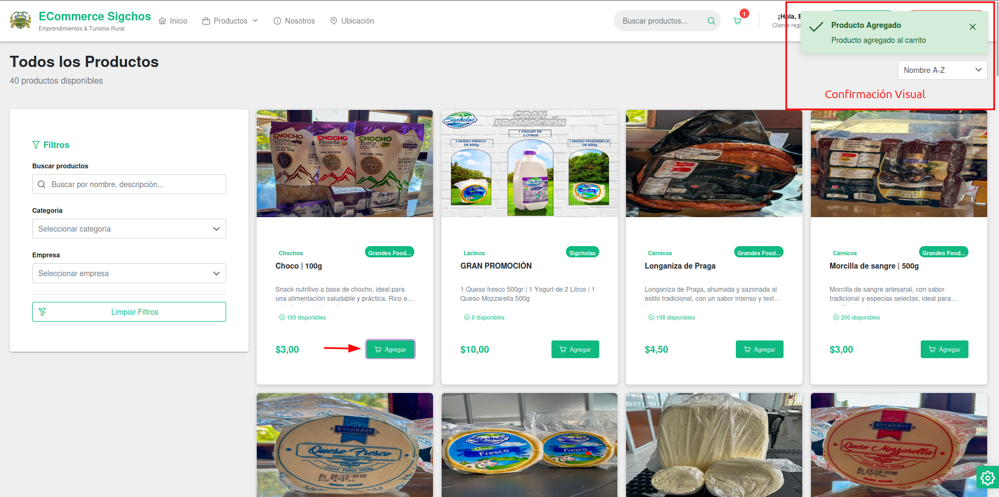{#fig-agregar-carrito}

## Gestión del carrito

Después de agregar los productos, el usuario puede seleccionar el ícono del carrito ubicado en la parte superior derecha. Esta opción abre el carrito de compras y muestra todos los productos seleccionados.

Como se observa en la @fig-seleccion-carrito, el ícono del carrito se encuentra en el encabezado de la plataforma:

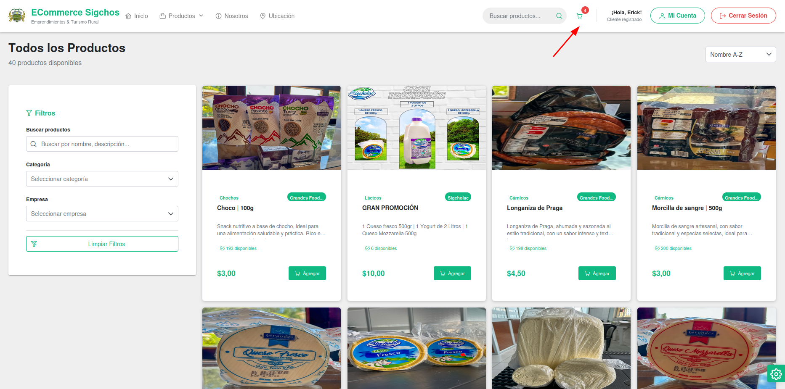{#fig-seleccion-carrito}

Desde el carrito de compras el usuario puede:

- Revisar todos los productos agregados al carrito.
- Verificar el resumen de costos (subtotal, impuestos, envío, total).
- Modificar cantidades, eliminar productos o vaciar carrito.
- Proceder al proceso de pago.
- Continuar comprando y agregar más productos.
- Vaciar todo el carrito.

\begin{infobox}[Resumen de Compra]
Verifique siempre el total del pedido antes de proceder al pago para asegurar que las cantidades y productos sean los deseados.
\end{infobox}

En la @fig-gestion-carrito se observa la interfaz de gestión del carrito:

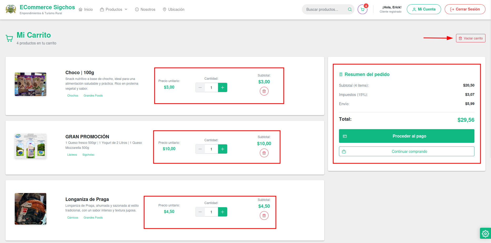{#fig-gestion-carrito}

## Proceso de pago (checkout)

### Fase 1: Datos de envío

Al momento de proceder al pago se debe proporcionar información personal y de envío para completar la compra. El sistema garantiza un proceso seguro y protegido para el manejo de datos sensibles.

1. **Sección: Información de Envío**

   **Datos de Envío**
   - **"Información Personal"**

    Campos obligatorios:
   - **Nombre***: Campo para ingresar el nombre (ejemplo: "Erick").
   - **Apellido***: Campo para ingresar el apellido (ejemplo: "Moreira").
   - **Cédula***: Campo para ingresar el número de identificación (ejemplo: "1315110534")
   - **Teléfono***: Campo para ingresar el número de contacto (ejemplo: "0972911176")

2. **Sección: Información de Contacto**
   - **Email***: Campo para ingresar el correo electrónico (ejemplo: "erickmoreira@gmail.com")
   - **Dirección de Envío***: Campo para ingresar la dirección completa.

3. **Aviso de seguridad**
   - **"Datos Seguros"**: Mensaje que garantiza: "Tus datos serán guardados de forma segura y encriptada para futuras compras"

\begin{importantbox}[Protección de Datos]
Toda la información personal ingresada durante el proceso de envío se maneja bajo protocolos de seguridad TLS para proteger su privacidad.
\end{importantbox}

Como se observa en la @fig-datos-envio, se requiere completar el formulario de envío:

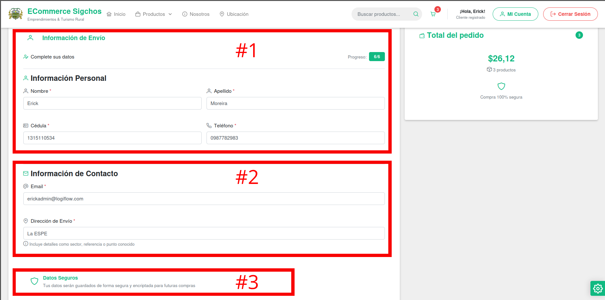{#fig-datos-envio}

4. **Confirmación y navegación**
   - **"Continuar a revisión"**: Si el formulario fue completado de manera exitosa se muestra el mensaje de validación exitosa.
   - **Botón "Volver al carrito"**: Para regresar y revisar o modificar los productos.

En la @fig-datos-envio-cont se observa el botón de confirmación una vez validados los datos:

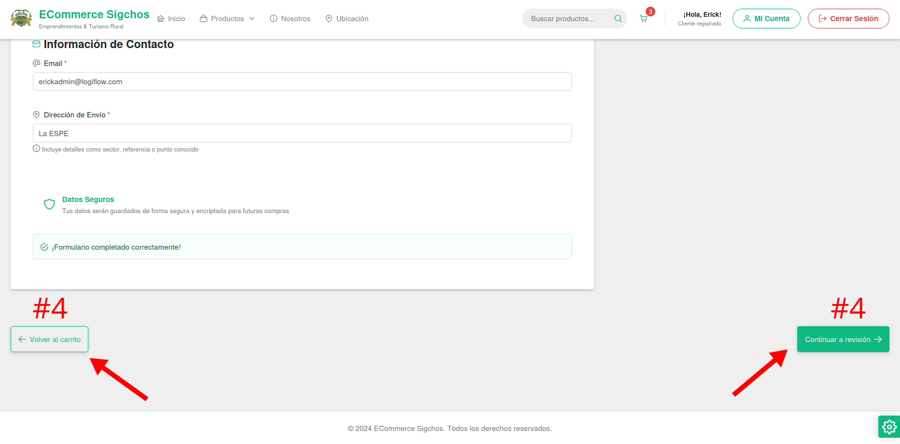{#fig-datos-envio-cont}

### Fase 2: Revisión

Se puede revisar y confirmar todos los detalles de su compra antes de proceder al pago. Es el paso final de verificación donde se muestran los datos del envío, los productos, cantidades y el desglose completo de costos. Como se observa en la @fig-revision-pedido, se presenta el resumen final:

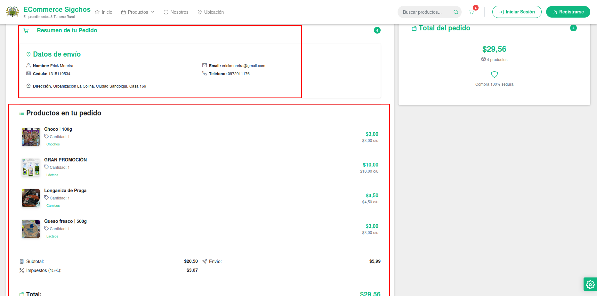{#fig-revision-pedido}

1. **Botones de acción final**
    - **"Continuar al Pago"**: Botón principal para avanzar al proceso de pago real.
    - **"Atrás"**: Botón para volver atrás y modificar algo.

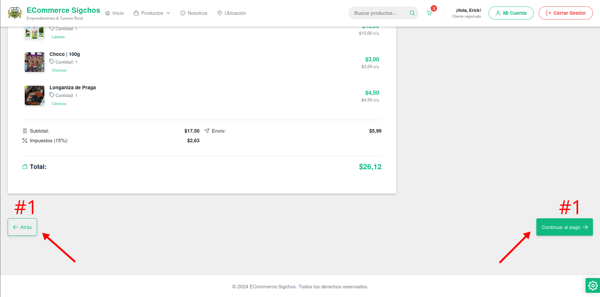{#fig-revision-cont}

### Fase 3: Procesamiento de pago

El sistema procesa de forma segura el pago del usuario. Durante esta etapa, se realizan validaciones, conexiones con pasarelas de pago y confirmación de la transacción en tiempo real. En la @fig-procesando-pago se observa el estado del procesamiento:

1. **Estado del procesamiento**
   - **"Procesando pago..."**: Primero se muestra el indicador principal de que la transacción está en curso

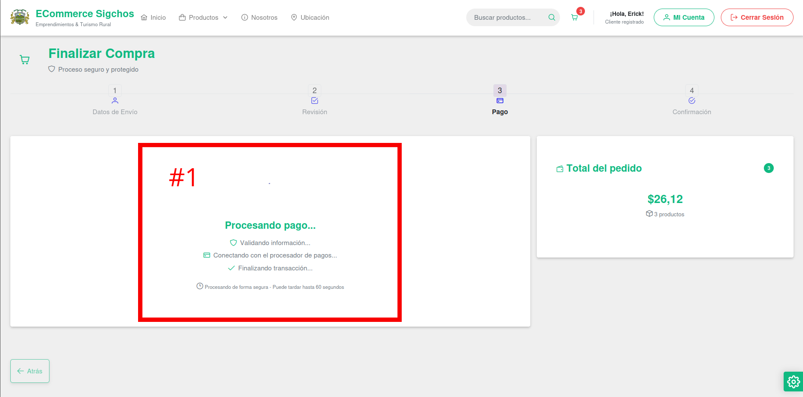{#fig-procesando-pago}

   - **Sub-etapas mostradas**:

   - **Validando información**: Verificación de datos del usuario y del pedido.
   - **Conectando con el procesador de pagos**: Establecimiento de conexión segura con la pasarela.
   - **Finalizando transacción**: Procesamiento final y confirmación.

Como se observa en la @fig-procesando-pago-cont, el sistema muestra el avance del procesamiento del pago:

2. **Resumen del pedido (lateral derecho)**
    - **"Total del pedido"**: Por ejemplo: $29.56
    - **Cantidad de productos**: Por ejemplo: 4 productos

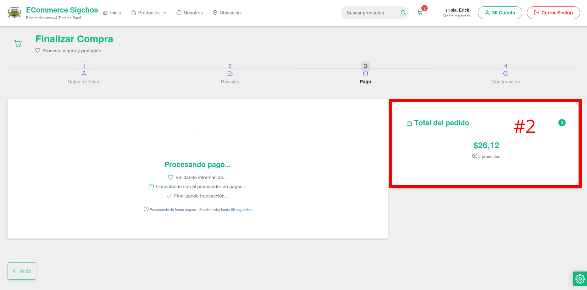{#fig-procesando-pago-cont}

### Fase 4: Confirmación

Se muestra la confirmación exitosa del pago y se proporciona al usuario su número de orden y el aviso de que recibirá un correo de confirmación. En la @fig-confirmacion-pedido se observa el mensaje de éxito final:

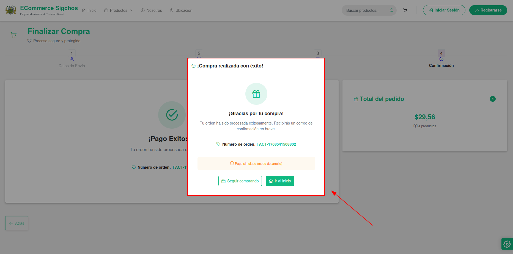{#fig-confirmacion-pedido}

## Pasarela de Pagos Payphone

La plataforma ofrece diferentes formas de pago para que el usuario pueda seleccionar la alternativa que prefiera. En la @fig-metodos-pago se muestran las opciones disponibles durante la fase de pago:

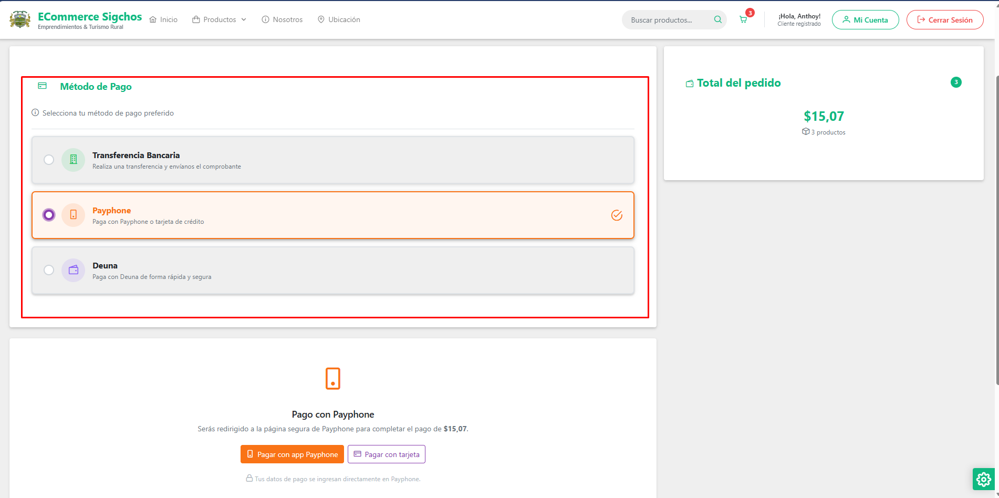{#fig-metodos-pago}

Entre las opciones disponibles se encuentran **Transferencia Bancaria**, **Payphone** y **Deuna**. Cada alternativa presenta instrucciones y campos diferentes para completar y verificar el pago.

### Selección del método de pago

Durante el proceso de pago, el usuario debe seleccionar la opción que desea utilizar. Para pagar mediante Payphone, debe seleccionar la tarjeta correspondiente a **Payphone**. La alternativa seleccionada se resaltará para indicar que está activa.

En la @fig-payphone-selector se observa Payphone seleccionado entre los métodos disponibles:

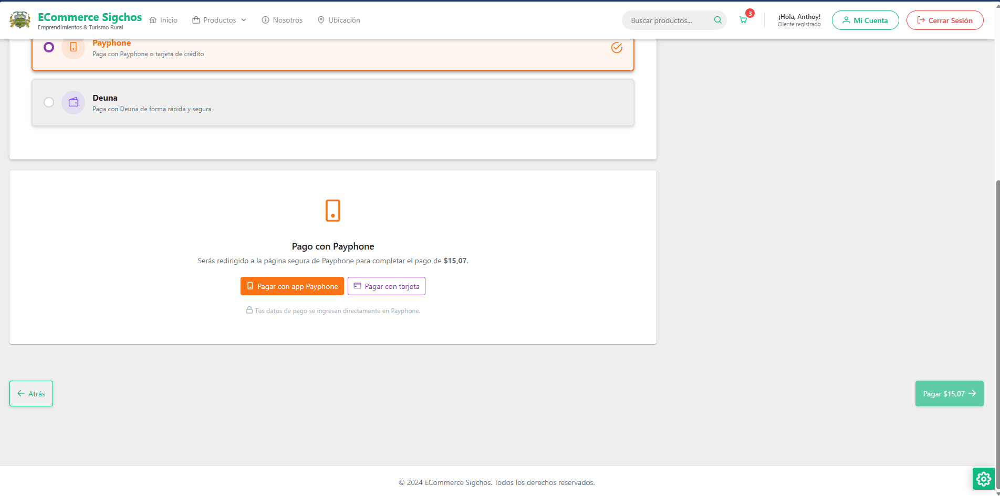{#fig-payphone-selector}

### Pantalla de pago con Payphone

Después de seleccionar Payphone, el sistema muestra una pantalla desde la cual el usuario puede elegir entre pagar con la aplicación móvil de Payphone o pagar con tarjeta.

En la @fig-payphone-pantalla se observan las dos alternativas disponibles:

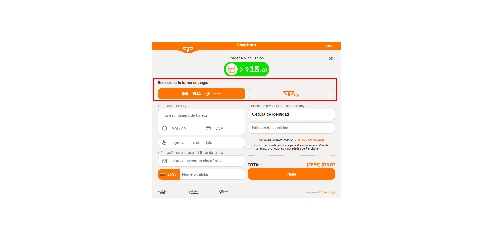{#fig-payphone-pantalla}

- **Pagar con app Payphone**: permite continuar el pago utilizando la aplicación móvil.
- **Pagar con tarjeta**: permite ingresar los datos de una tarjeta aceptada por Payphone.

Al seleccionar una de las alternativas, se abrirá la pantalla correspondiente para completar la información del pago:

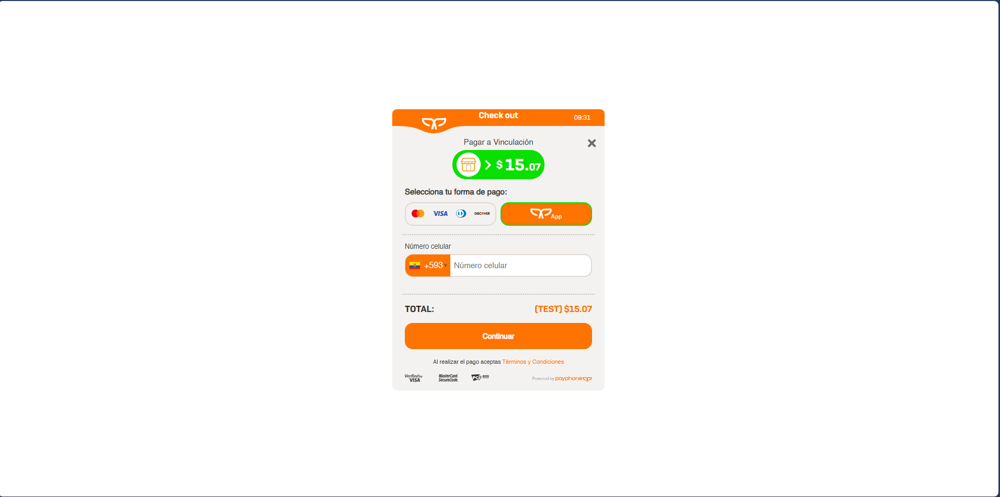{#fig-payphone-opciones}

### Interfaz segura de Payphone

La interfaz de Payphone se carga en un entorno seguro para completar la transacción. Según la alternativa seleccionada, el usuario podrá ingresar los datos de su tarjeta o el número de celular asociado a la aplicación Payphone.

En la @fig-payphone-interfaz se observa la opción de Payphone seleccionada antes de continuar con el pago:

{#fig-payphone-interfaz}

El usuario debe revisar el monto mostrado y completar únicamente los datos solicitados por Payphone. La información de pago se ingresa directamente en la interfaz de la pasarela.

### Estados de confirmación de pago

Una vez que el cliente autoriza y envía el pago en la pasarela, será redirigido automáticamente a nuestra tienda, donde se evaluará la transacción en tiempo real:

1. **Estado "Verificando":**
   Mientras el sistema se conecta con los servidores de Payphone para confirmar la validez de los fondos, se mostrará una pantalla de carga.

   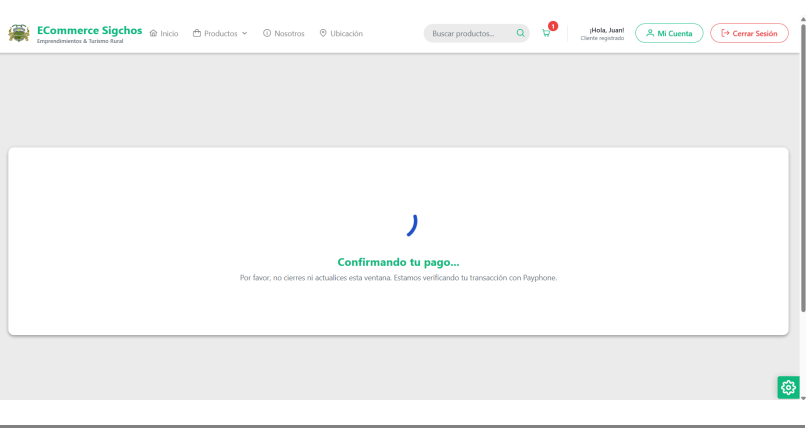{#fig-payphone-verificando}

2. **Pago Exitoso:**
   Si la transacción fue aprobada, se presentará el mensaje "¡Pago Exitoso!", incluyendo el número de transacción oficial generado por Payphone y el monto cobrado.

   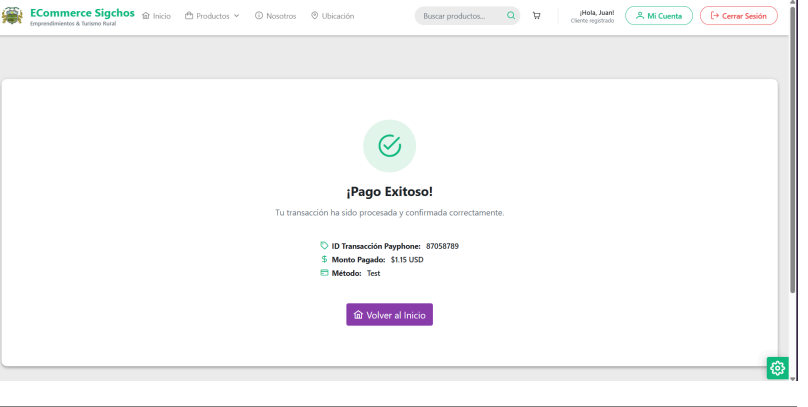{#fig-payphone-exitoso}

3. **Pago Cancelado:**
   Si el usuario cancela la operación o hay un problema con la tarjeta, el sistema registrará la notificación de "Pago Cancelado" sin realizar ningún cargo económico al cliente.

   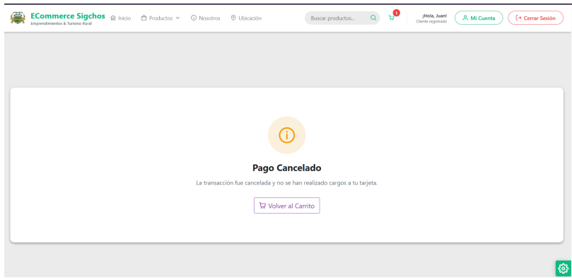{#fig-payphone-cancelado}

\begin{infobox}[Respaldo Automático]
Cuando un pago a través de Payphone es exitoso, el sistema registra automáticamente la venta como "COMPLETADA", descuenta el inventario e informa al emprendedor para el despacho del producto.
\end{infobox}

## Factura de la compra

Después de completar la compra, el cliente puede consultar la factura generada por el sistema. Esta factura sirve como comprobante de los productos comprados y del valor pagado.

- Ingresar al historial o detalle de la compra.
- Buscar la factura del pedido.
- Revisar los datos del cliente, productos, subtotal, IVA y total.
- Guardar o descargar el comprobante si lo necesita.

## Seguimiento del pedido

El cliente puede revisar cómo avanza su pedido desde que se confirma el pago hasta que llega a su destino. El estado del pedido se actualiza cuando el emprendedor cambia la etapa del proceso.

Estados que puede visualizar el cliente:

- **Pago aprobado:** el pago fue confirmado correctamente.
- **En preparación:** el emprendedor está preparando el pedido.
- **Listo para envío:** el pedido ya está listo para ser entregado.
- **En camino:** el pedido se encuentra en proceso de entrega.
- **Entregado:** el pedido llegó al cliente.

De esta manera, el cliente puede conocer todo el proceso de su pedido sin tener que comunicarse directamente con el emprendedor.

## Pagos por transferencia bancaria

La opción de **Transferencia Bancaria** permite realizar el pago desde la cuenta bancaria del usuario hacia una de las cuentas registradas por el emprendimiento o la institución. Después de realizar la transferencia, el usuario debe registrar los datos de la operación y enviar el comprobante para que el pago pueda ser revisado.

### Selección del método de pago

En la pantalla de métodos de pago, el usuario debe seleccionar **Transferencia Bancaria**. La opción seleccionada se resaltará y el sistema mostrará las instrucciones y el formulario correspondiente.

En la @fig-eleccion-transferencia se muestra la selección de este método:

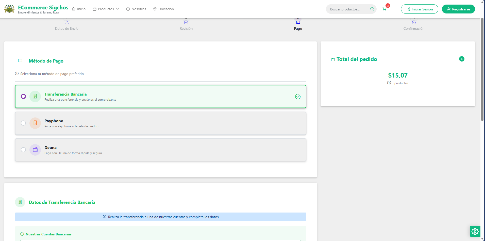{#fig-eleccion-transferencia}

### Cuentas bancarias disponibles y registro del pago

Después de seleccionar la transferencia bancaria, el sistema mostrará las cuentas disponibles y el formulario para registrar la operación. En la @fig-renderizado-transferencia se observan ambas partes:

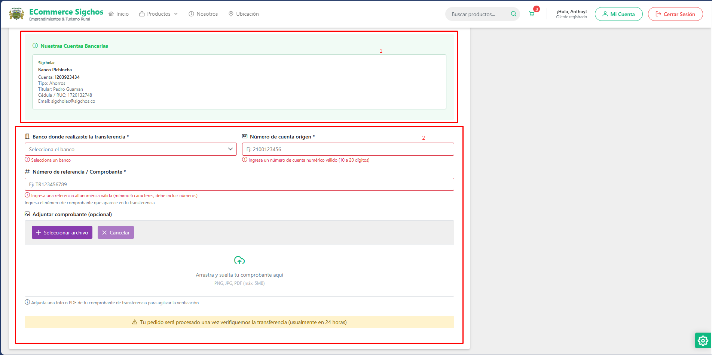{#fig-renderizado-transferencia}

1. **Nuestras cuentas**

   En esta sección se muestran las cuentas bancarias disponibles para realizar la transferencia. El usuario debe utilizar los datos de una de estas cuentas y conservar el comprobante de la operación.

2. **Formulario de pago**

   El formulario permite informar al sistema que la transferencia fue realizada. Para completarlo, el usuario debe:

   - Seleccionar el banco desde el cual realizó la transferencia.
   - Ingresar el número de la cuenta de origen.
   - Ingresar el número de referencia o comprobante de la transferencia.
   - Adjuntar una imagen o PDF del comprobante, de forma opcional, para facilitar la verificación.

   El archivo adjunto puede ser una imagen PNG o JPG, o un documento PDF, con un tamaño máximo de 5 MB. Los botones **Seleccionar archivo** y **Cancelar** permiten cargar o retirar el comprobante antes de enviar la información.

   El pedido será procesado después de que el equipo responsable verifique la transferencia. Esta verificación puede tardar normalmente hasta 24 horas.

## Pagos con Deuna

La opción de **Deuna** permite pagar mediante la aplicación móvil de Deuna utilizando un código QR. El usuario debe tener instalada la aplicación en su dispositivo móvil y contar con una cuenta habilitada para realizar el pago.

### Selección del método de pago

En la pantalla de métodos de pago, el usuario debe seleccionar **Deuna**. Una vez seleccionada la opción, el sistema mostrará el código QR y las instrucciones para completar la operación.

En la @fig-eleccion-deuna se muestra la selección de Deuna:

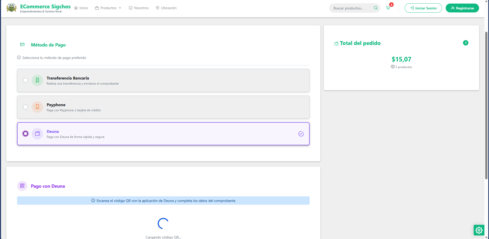{#fig-eleccion-deuna}

### Código QR y formulario de confirmación

Al seleccionar Deuna, el sistema genera un código QR asociado al pedido. El usuario debe abrir la aplicación Deuna en su teléfono móvil, elegir la opción para escanear un código QR y apuntar la cámara hacia el código mostrado en la pantalla.

Después de confirmar el pago desde la aplicación, el usuario debe completar el formulario de verificación que aparece debajo del código QR:

1. **Código QR de Deuna**

   El código debe escanearse utilizando la aplicación móvil de Deuna. Desde la aplicación se confirma el monto y se autoriza la transferencia.

2. **Formulario de confirmación**

   El formulario permite registrar los datos de la operación para que el equipo responsable pueda verificarla. El usuario debe ingresar:

   - Número de cuenta de origen.
   - Número de referencia o comprobante generado por Deuna.
   - Comprobante de pago, de forma opcional, en formato PNG, JPG o PDF, con un tamaño máximo de 5 MB.

En la @fig-qr-deuna se observan el código QR, las instrucciones de pago y el formulario de confirmación:

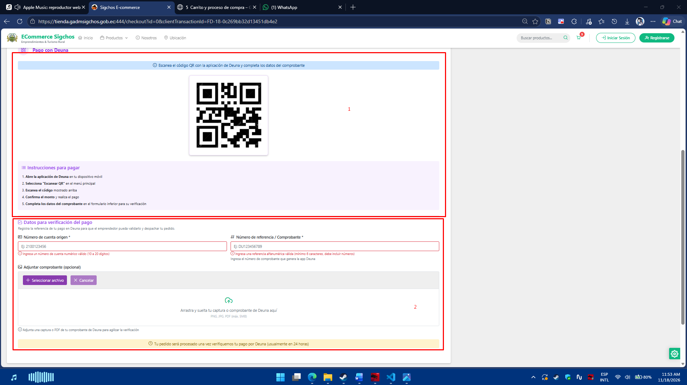{#fig-qr-deuna}

El pedido será procesado una vez que el pago sea verificado. El usuario debe conservar el comprobante de la operación hasta finalizar la validación.

Estos son todos los pasos para realizar compras de manera exitosa y segura dentro de la plataforma de Comercio Electrónico para los Emprendimientos del Cantón Sigchos.
