# Sección de Administración

Esta sección explica las funciones disponibles para el administrador del sistema y para los emprendedores que gestionan sus productos, ventas, pagos y pedidos. Las instrucciones se enfocan en las tareas que se realizan desde el panel; los aspectos técnicos de configuración y funcionamiento interno se describen en el manual técnico.

## Panel de Administración

El panel de administración es la pantalla principal desde la que se supervisa el funcionamiento de **Sistema Sigchos E-Commerce**. Desde este espacio se pueden consultar las métricas generales y acceder a las herramientas de usuarios, productos, categorías, empresas, inventario y ventas.

### Menú principal de gestión

En el menú lateral se encuentran las opciones disponibles para administrar la plataforma:

- **Dashboard**: muestra un resumen de la actividad del sistema.
- **Usuarios**: permite gestionar las cuentas registradas.
- **Productos**: permite administrar el catálogo.
- **Categorías**: organiza los productos por tipo.
- **Empresas**: gestiona los emprendimientos asociados.
- **Inventario**: permite controlar las existencias.
- **Ventas**: permite consultar y dar seguimiento a los pedidos.

### Métricas y estadísticas principales

El dashboard presenta tarjetas con información resumida para facilitar la supervisión del sistema:

**a. Productos activos**

Muestra la cantidad de productos que se encuentran disponibles en el catálogo.

**b. Ventas del día**

Indica el número de ventas realizadas durante el día.

**c. Ingresos del mes**

Presenta el valor acumulado de los ingresos generados durante el mes.

**d. Visitas del sitio**

Registra las visitas que recibe la plataforma y muestra tanto el total acumulado como las visitas del día. Esta información permite conocer el nivel de uso y alcance del sitio.

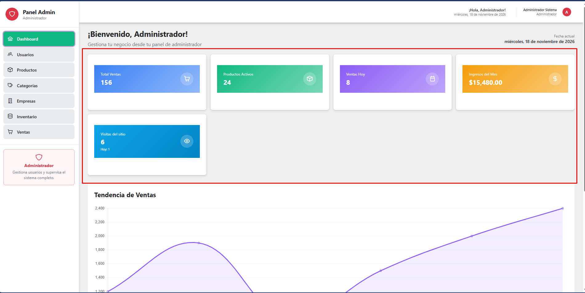{#fig-admin-panel-visitas}

En la @fig-admin-panel se observa el panel de administración principal con sus métricas generales:

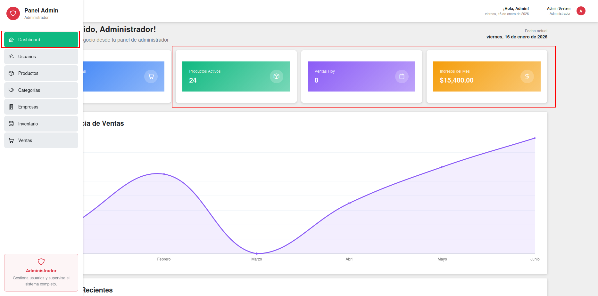{#fig-admin-panel}

### Gestión de usuarios

La opción **Usuarios** permite consultar las cuentas registradas y realizar acciones como agregar un usuario, revisar sus datos, editar la información, desactivarlo o eliminarlo.

\begin{importantbox}[Privacidad de datos]
El administrador debe manejar con confidencialidad los datos personales de los usuarios registrados y utilizarlos únicamente para las funciones autorizadas del sistema.
\end{importantbox}

Como se observa en la @fig-admin-usuarios, el módulo de usuarios permite administrar las cuentas registradas:

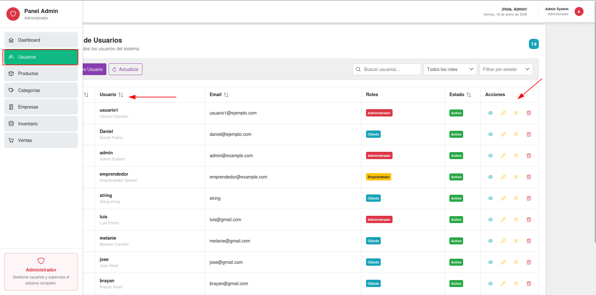{#fig-admin-usuarios}

### Gestión de productos

La opción **Productos** permite administrar el catálogo completo. Desde allí se puede agregar un producto, consultar sus detalles, editar su información o eliminarlo cuando corresponda.

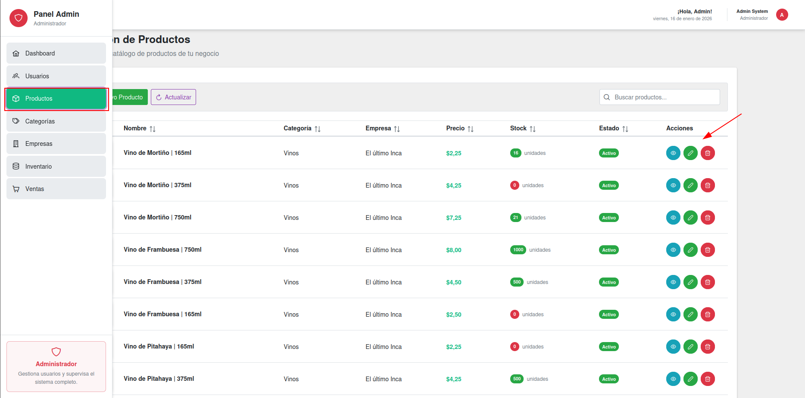{#fig-admin-productos}

### Gestión de categorías

La opción **Categorías** permite agregar, consultar, editar y eliminar las categorías utilizadas para organizar los productos.

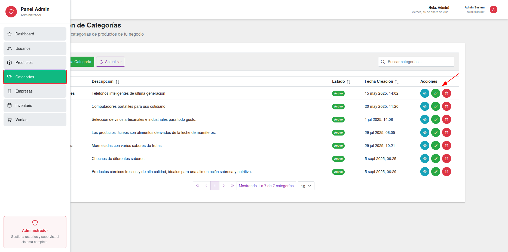{#fig-admin-categorias}

### Gestión de empresas

La opción **Empresas** permite administrar la información de los emprendedores y empresas asociadas a la plataforma.

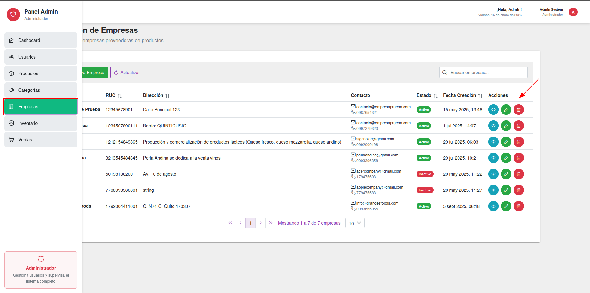{#fig-admin-empresas}

### Control de inventario

La opción **Inventario** permite revisar la disponibilidad de los productos, editar existencias y realizar ajustes individuales o masivos.

\begin{importantbox}[Control de inventario]
Antes de realizar cambios masivos, revise cuidadosamente los productos y las cantidades que se modificarán, ya que estos cambios pueden afectar la disponibilidad mostrada a los clientes.
\end{importantbox}

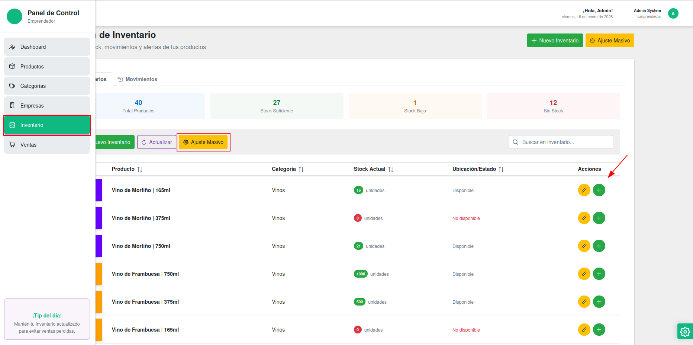{#fig-admin-inventario}

### Consulta de ventas

La opción **Ventas** permite consultar los pedidos y revisar su estado. También permite abrir el detalle de una venta, completarla o cancelarla según corresponda.

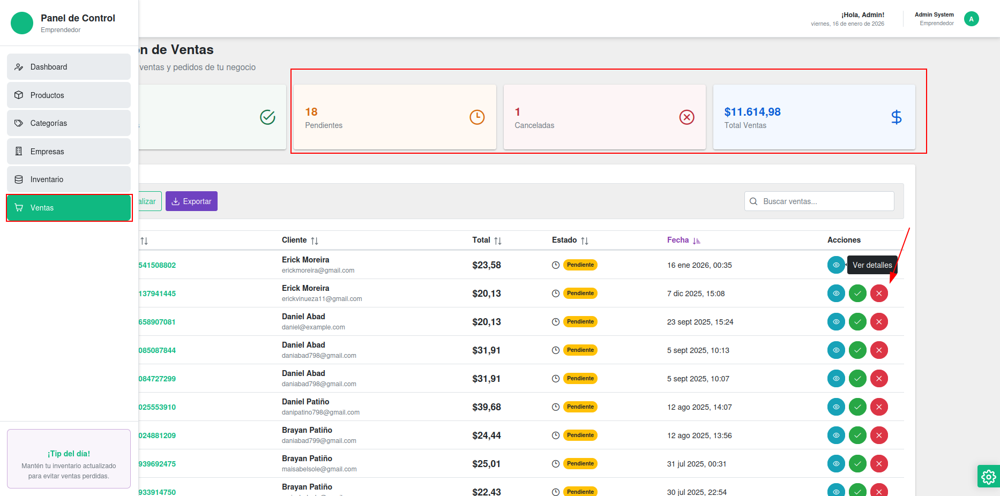{#fig-admin-ventas}

Cuando una compra se realiza mediante **Payphone**, el sistema registra automáticamente el identificador de la transacción y actualiza la venta de acuerdo con la confirmación recibida. La venta puede visualizarse desde el panel correspondiente para continuar con su despacho.

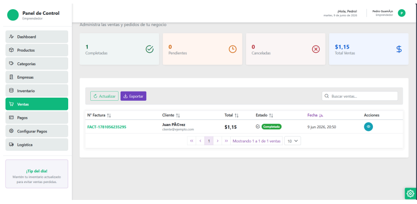{#fig-admin-venta-payphone}

### Función del panel

En resumen, el panel permite al administrador:

- Acceder a las herramientas de gestión de la plataforma.
- Consultar el estado general del negocio.
- Gestionar usuarios, productos, empresas y categorías.
- Controlar el inventario y la disponibilidad de los productos.
- Supervisar las ventas y los pedidos.
- Consultar las visitas y otras métricas del sitio.

## Gestión de productos

- Seleccionar la opción **Productos**.
- Usar **Nuevo producto** para registrar un artículo.
- Completar datos como nombre, categoría, empresa, precio y stock.
- Editar un producto cuando sea necesario.
- Mantener actualizado el stock para evitar ventas de productos no disponibles.

\begin{infobox}[Control de catálogo]
Mantener el catálogo y los niveles de stock actualizados es fundamental para brindar una buena experiencia de compra y evitar reclamos por productos agotados.
\end{infobox}

## Revisión de ventas y cobros

El emprendedor puede revisar las compras realizadas por los clientes y verificar el estado de los pagos desde el panel. Para consultar esta información, debe ingresar a la opción **Pagos** o al apartado de ventas disponible para su cuenta.

En la pantalla de gestión se muestran los pagos pendientes de aprobación y el historial de pagos. La tabla permite identificar la factura, el cliente, el método utilizado, el monto, la fecha y el comprobante registrado.

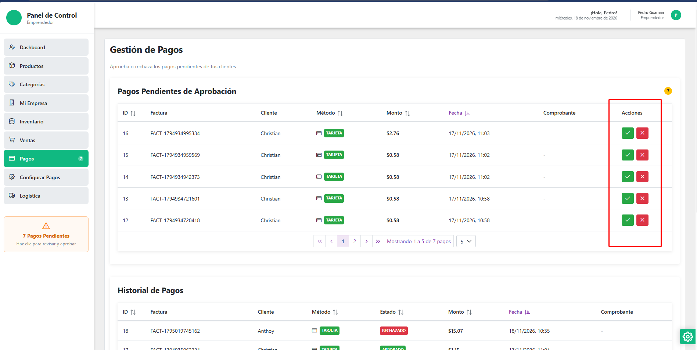{#fig-gestion-pagos}

Para revisar un cobro, se recomienda:

1. Consultar los datos de la factura y del cliente.
2. Verificar el método de pago y el monto recibido.
3. Revisar el comprobante cuando el método lo requiera.
4. Seleccionar el botón verde para aprobar el pago o el botón rojo para rechazarlo, según la verificación realizada.

Los pagos aprobados permiten continuar con la preparación y despacho del pedido. Si un pago es rechazado, se debe revisar la información registrada y atender cualquier consulta del cliente por los canales de contacto disponibles.

## Actualización de la logística del pedido

El emprendedor actualiza la logística del pedido desde la opción **Logística**. En esta pantalla se muestra una lista de pedidos con su número de factura, cliente, estado actual y fecha de la última actualización.

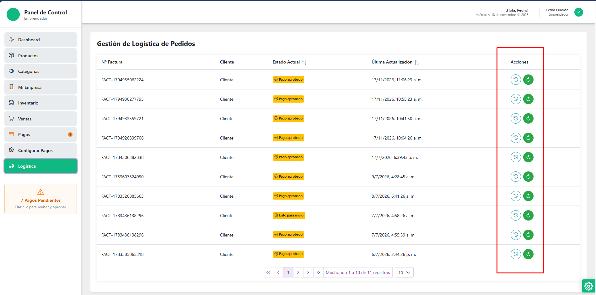{#fig-logistica}

En la columna **Acciones** se encuentran los botones para consultar el historial y actualizar el estado del pedido. Cada cambio permite que el cliente conozca el avance de su compra desde su cuenta.

El proceso recomendado es el siguiente:

- Verificar que el pago esté aprobado.
- Cambiar el estado a **En preparación** cuando se empiece a preparar el pedido.
- Cambiar el estado a **Listo para envío** cuando el pedido esté empacado.
- Cambiar el estado a **En camino** cuando el pedido salga para entrega.
- Cambiar el estado a **Entregado** cuando el cliente reciba el pedido.

Al seleccionar la acción para actualizar el pedido se abre un formulario. En este formulario se debe seleccionar el **Estado logístico** y, si es necesario, completar la descripción, la ubicación, el responsable y las observaciones. El botón **Actualizar** guarda el cambio; **Cancelar** cierra el formulario sin modificar la información.

{#fig-actualizar-estado}

\begin{importantbox}[Transparencia logística]
Actualice los estados en el orden correspondiente y agregue información clara cuando el pedido cambie de ubicación o de responsable. Esto permite que el cliente tenga un seguimiento confiable de su compra.
\end{importantbox}

## Configuración de pagos

La opción **Configurar Pagos** permite al emprendedor mantener actualizada la información que utilizarán los clientes para pagar sus pedidos. La pantalla está organizada mediante pestañas para configurar la transferencia bancaria, Deuna, Payphone y el costo de envío.

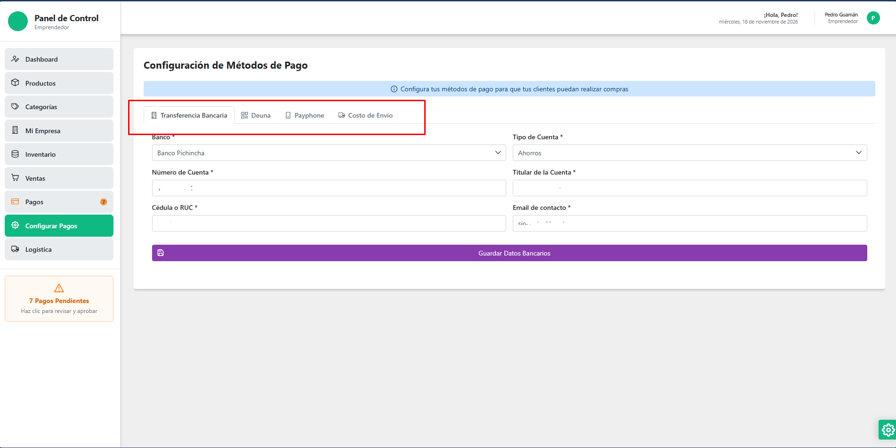{#fig-configurar-pagos}

### Transferencia bancaria

En esta pestaña se registran o actualizan los datos de la cuenta bancaria que se mostrarán al cliente. Se deben completar el banco, el tipo de cuenta, el número de cuenta, el titular, la cédula o RUC y el correo electrónico de contacto. Al finalizar, se selecciona **Guardar Datos Bancarios**.

### Deuna

Esta pestaña permite configurar el pago mediante Deuna y actualizar el código QR que utilizarán los clientes para realizar la transferencia desde la aplicación. Antes de guardar los cambios, verifique que el QR corresponda a la cuenta que recibirá los pagos.

### Payphone

Desde esta pestaña se registra o actualiza la configuración de Payphone para que el método esté disponible durante el proceso de compra. La configuración debe mantenerse vigente para que los clientes puedan pagar mediante la aplicación o tarjeta, de acuerdo con las opciones habilitadas.

### Costo de envío

Esta pestaña permite actualizar el valor del costo de envío que se aplicará a los pedidos. Revise el valor antes de guardarlo, ya que se reflejará en el resumen y total de la compra del cliente.

\begin{importantbox}[Verificación de la configuración]
Después de guardar cambios, compruebe que los datos de la cuenta, el código QR, Payphone y el costo de envío sean correctos. Una configuración actualizada evita errores durante el pago y el despacho de los pedidos.
\end{importantbox}

## Recomendaciones para el emprendedor

- Mantener actualizados los productos y precios.
- Revisar los pagos y las ventas con regularidad.
- Actualizar los estados logísticos apenas cambie la etapa del pedido.
- Usar descripciones claras para que el cliente comprenda cada producto.
- Verificar el stock antes de publicar o promocionar productos.
- Comprobar periódicamente la información de los métodos de pago y el costo de envío.
