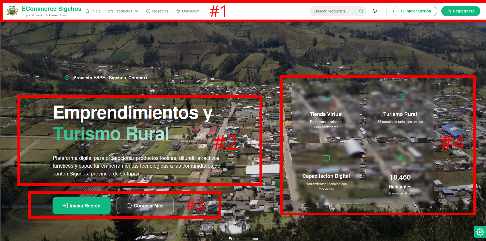
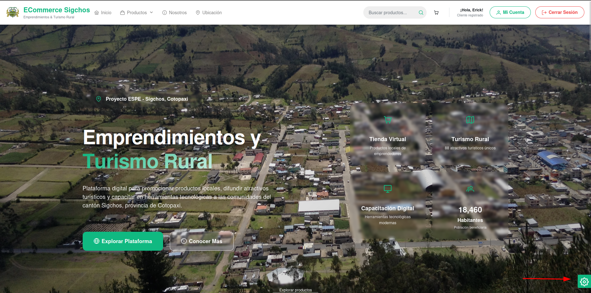
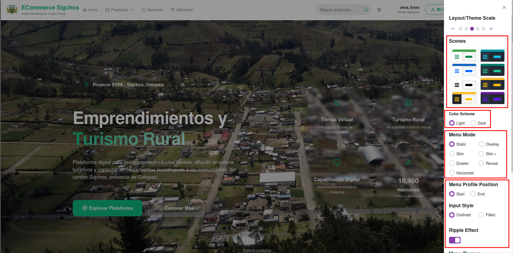
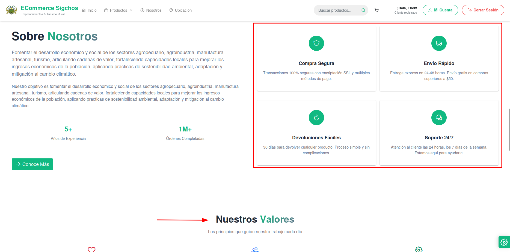
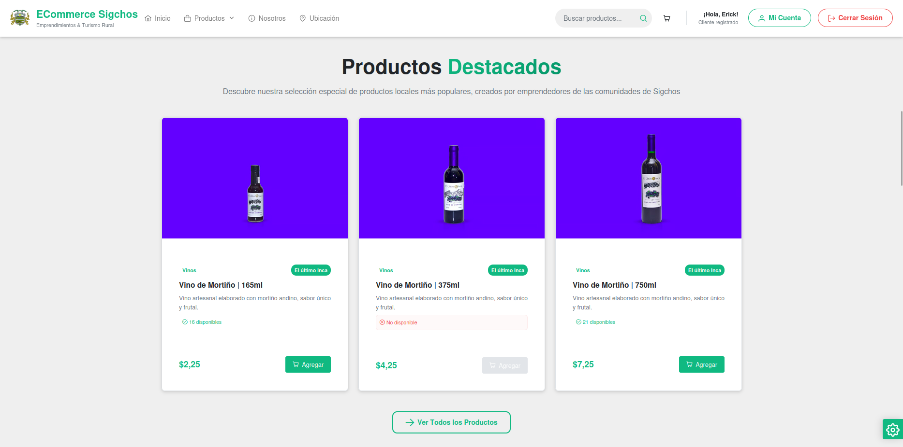
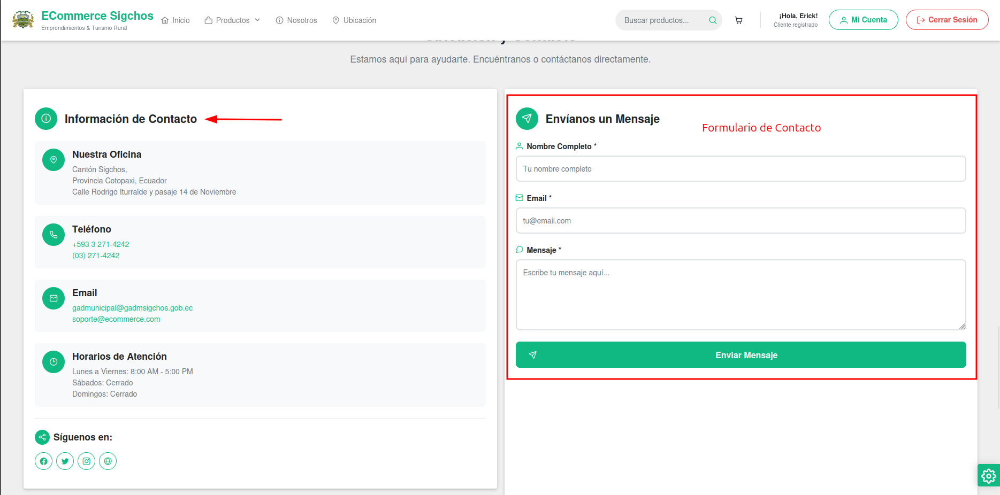
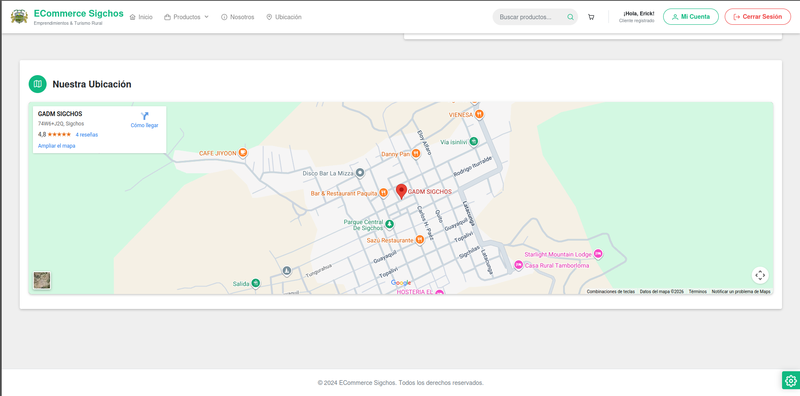

# Sección Pantalla Principal

## Vista general

Esta es la pantalla principal de la plataforma \textbf{ECommerce Sigchos}, un portal digital diseñado para impulsar el comercio local en las comunidades del cantón Sigchos.

En la siguiente @fig-vistageneral se observa la vista inicial de la plataforma, donde se aprecian los componentes de navegación principales:

{#fig-vistageneral}

### Elementos principales visibles:

1. **Encabezado y logotipo**  
    - Muestra el nombre del proyecto: **ECommerce Sigchos** con su logotipo.
    - Se muestra la barra de navegación para las secciones de Inicio, Productos, Nosotros y Ubicación.
    - Se muestra la barra de búsqueda para encontrar productos de manera más rápida y el ícono de carrito para acceder al carrito de compras.
    - Se muestra los botones de Iniciar Sesión y Registrarse.

2. **Información del proyecto**  
   - Bajo el título **“Emprendimientos y Turismo Rural”**, se describe el propósito de la plataforma: promover productos locales, ofrecer información turística actualizada y capacitar en herramientas tecnológicas a las comunidades de la región.

3. **Accesos rápidos**  
   - **Iniciar Sesión**: Enlace para acceder al inicio de sesión de usuarios registrados.  
   - **Conocer Mas**: Acceso a más contenido sobre los productos destacados.

4. **Secciones destacadas**  
   - **Tienda Virtual**
   - **Turismo Rural**
   - **Capacitación Digital**
   - **Población Beneficiaria**

### Función:
Esta vista sirve como punto de entrada principal, desde donde los usuarios pueden:

- Navegar a las secciones clave.
- Conocer el propósito de la plataforma.

## Personalización de temas
Al presionar el ícono de configuración podemos acceder a distintas opciones para personalizar la apariencia de la plataforma. Como se observa en la @fig-temas-icon, se despliega un menú con opciones de temas:

\begin{importantbox}[Personalización]
El usuario puede cambiar el color principal de la interfaz y alternar entre modo claro y oscuro para mejorar su experiencia visual.
\end{importantbox}

{#fig-temas-icon}

Opciones que contiene:

- Opción alternar temas con distintas paletas de colores para la aplicación.
- Opción para alternar temas entre claro y oscuro.
- Demás preferencias de visualización como tamaño de escala.

En la @fig-temas-panel se ilustra el panel completo de opciones de personalización:

{#fig-temas-panel}

## Sección "Sobre Nosotros"

Presenta los objetivos y valores del proyecto **ECommerce Sigchos**, junto con métricas de impacto y garantías de servicio para los usuarios.

Esta sección permite:

- Comprender la misión y el alcance social del proyecto.
- Confiar en la experiencia y escala de operaciones.
- Conocer las garantías de seguridad, envío, devoluciones y soporte.
- Identificar los valores que guían la plataforma.

\begin{infobox}[Valores del GAD]
El proyecto busca la transparencia y la confianza del usuario mediante la exposición clara de sus garantías y misión social.
\end{infobox}

En la @fig-sobrenosotros se muestra el aspecto visual de la sección informativa:

{#fig-sobrenosotros}

## Productos destacados

Muestra una selección especial de productos locales más populares, elaborados por emprendedores de las comunidades de Sigchos. Los productos destacados son una parte central del catálogo del ecommerce.

Esta sección permite al usuario:

- Explorar los productos más populares y representativos de la región.
- Conocer las características básicas de cada producto destacado.
- Identificar rápidamente ofertas especiales o productos emblemáticos.
- Agregar los productos destacados al carrito de compras de una manera más rápida.

Como se observa en la @fig-productosdestacados, se detallan las tarjetas de los productos en la vista principal:

{#fig-productosdestacados}

## Ubicación y contacto

Proporciona toda la información necesaria para que los usuarios puedan localizar físicamente la oficina o contactar directamente con el equipo de atención. Incluye datos de ubicación, horarios de atención, acceso rápido a las redes sociales y un formulario de contacto que debe ser llenado con tu Nombre Completo, tu Email y el Mensaje que desees enviar. En la @fig-ubicacion se observa la apariencia del formulario:

{#fig-ubicacion}

## Nuestra ubicación

Proporciona la ubicación exacta en el mapa del Gobierno Autónomo Descentralizado Municipal del cantón Sigchos. Como se observa en la @fig-mapa, se dispone de un mapa interactivo integrado en la plataforma:

{#fig-mapa}

