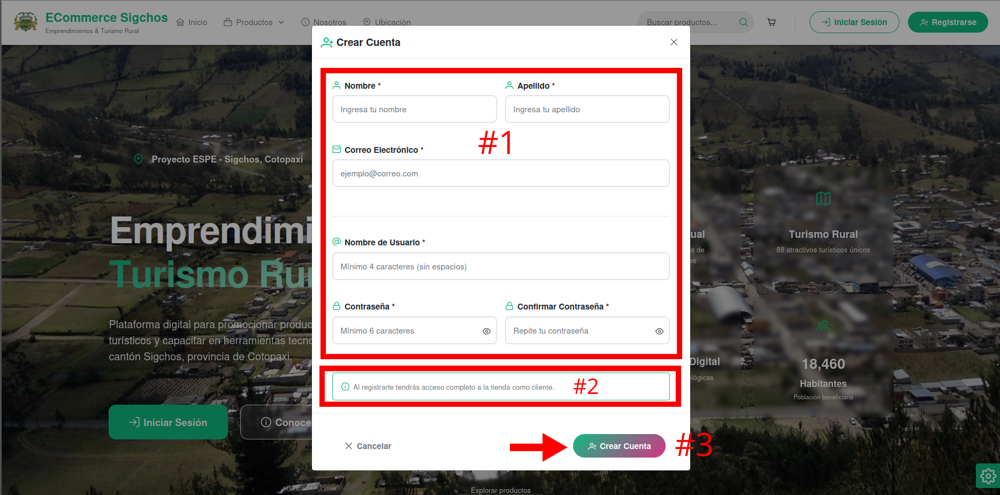
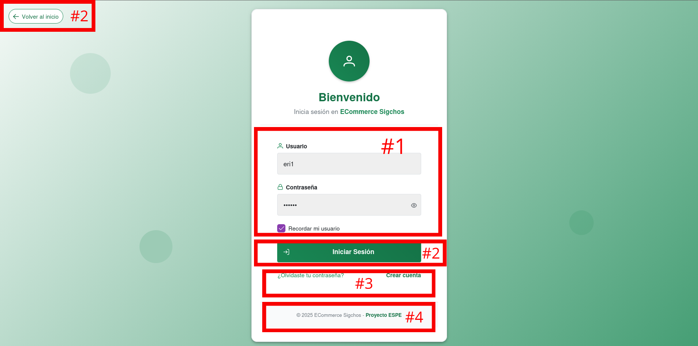
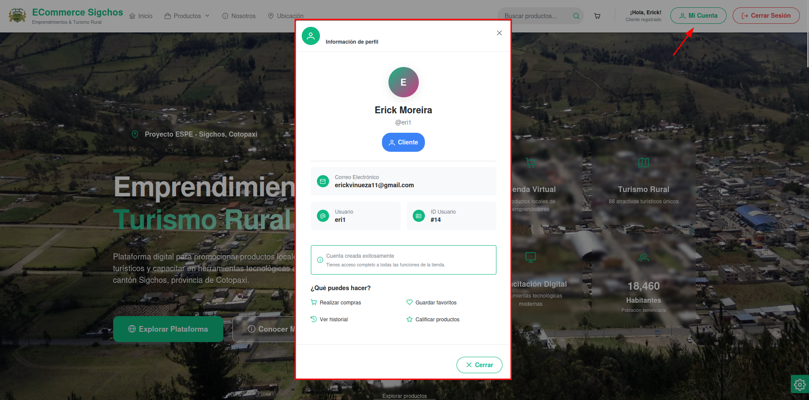

# Sección Gestión de Cuenta: Registro y Login

## Creación de cuenta

Permite a los nuevos usuarios registrarse en la plataforma **ECommerce Sigchos** para acceder a distintas funcionalidades del sistema, como realizar compras y gestionar pedidos.

1. **Campos del formulario de registro**  
   - **Información personal**:
     - **Nombre ***: Campo obligatorio para el primer nombre (ejemplo: "Erick")
     - **Apellido ***: Campo obligatorio para el apellido (ejemplo: "Moreira")
     - **Correo Electrónico ***: Campo para email (ejemplo: "erickmoreira@gmail.com")

   - **Credenciales de acceso**:
     - **Nombre de Usuario***: Campo para elegir un nombre de usuario único
     - **Contraseña ***: Campo para establecer una contraseña segura 
     - **Confirmar Contraseña ***: Campo para verificar la contraseña ingresada

2. **Nota informativa**  
    - **Texto**: "Al registrarse, usted tendrá acceso completo a la tienda como cliente"

3. **Botón de acción**  
   - **"Crear Cuenta"**: Botón para enviar el formulario y completar el registro.

\begin{infobox}[Registro]
Es fundamental utilizar un correo electrónico válido para recibir notificaciones sobre el estado de sus pedidos.
\end{infobox}

En la @fig-creacioncuenta se observa el formulario de registro con los campos obligatorios marcados con asteriscos:

{#fig-creacioncuenta}

## Inicio de sesión

Permite a los usuarios registrados acceder a su cuenta personal en la plataforma **ECommerce Sigchos** para gestionar compras, consultar pedidos, calificar productos, ver historial y guardar favoritos.

1. **Formulario de inicio de sesión**  
   - **Campo "Usuario"**: Para ingresar el nombre de usuario registrado (ejemplo: "eri1").
   - **Campo "Contraseña"**: Para ingresar la contraseña asociada a la cuenta (es mostrada con puntos por seguridad).
   - **Casilla de verificación**: **"Recordar mi usuario"**: Opción para recordar el usuario y no volverlo a ingresar siempre.

3. **Botones de acción principal**  
   - **Iniciar Sesión**: Botón para enviar las credenciales y acceder a la cuenta
   - **Volver al Inicio**: Botón para regresar a la página principal

4. **Enlaces de recuperación y registro**  
   - **¿Olvidaste tu contraseña?**: Enlace para recuperar o restablecer la contraseña en caso de olvido
   - **Crear cuenta**: Enlace para redirigir a nuevos usuarios al formulario de registro

5. **Pie de página institucional**  
   - **"© 2025 ECommerce Sigchos - Proyecto ESPE"**: Información de derechos de autor y afiliación institucional

\begin{importantbox}[Seguridad]
Nunca comparta su contraseña con terceros. El sistema cifra automáticamente sus credenciales para proteger su privacidad.
\end{importantbox}

Como se observa en la @fig-iniciodesesion, el formulario de acceso es sencillo y directo:

{#fig-iniciodesesion}

## Mi cuenta

Una vez iniciada la sesión en la página principal se activa el botón "Mi cuenta" para visualizar datos de mi cuenta como el correo electrónico, mi nombre de usuario, mi ID de usuario y las funcionalidades a las que tengo acceso. En la @fig-micuenta se observa el panel de información del usuario:

{#fig-micuenta}

