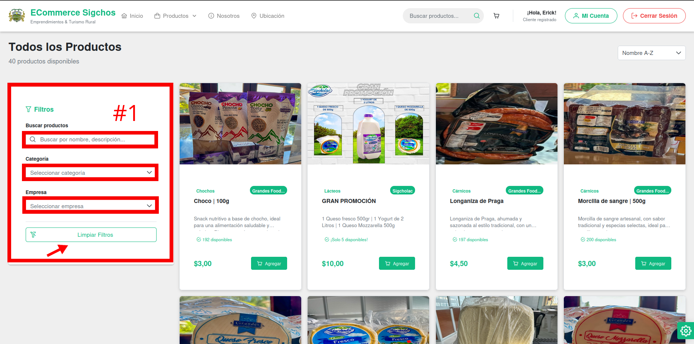
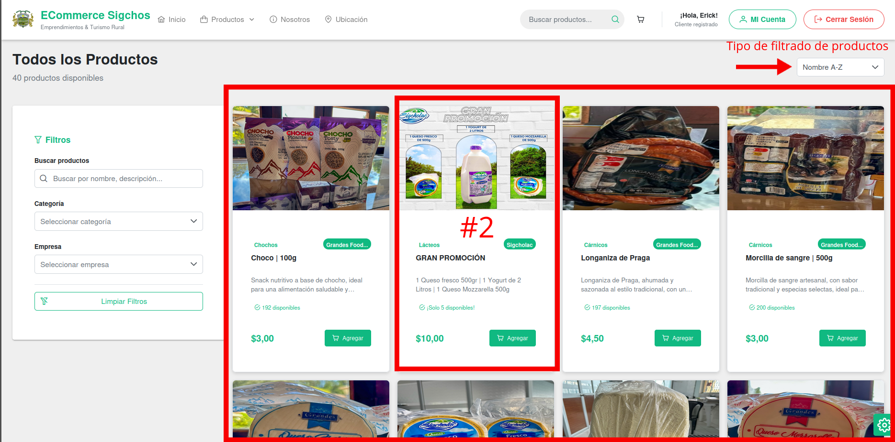
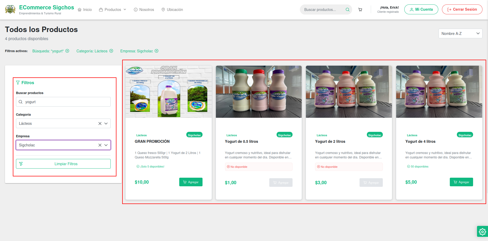

# Sección Productos

## Todos los productos

Se presenta el catálogo completo de productos disponibles en **ECommerce Sigchos**, permitiendo a los usuarios explorar, filtrar y seleccionar productos según sus preferencias. La interfaz está dividida en dos áreas principales: los filtros de búsqueda y la visualización principal de todos los productos.

1. **Área de filtros (lado izquierdo)**
   - **Buscar por nombre, descripción...**: Puede ingresar palabras clave y filtrar productos por nombre o descripción.
   - **Seleccionar categoría**: Menú desplegable para filtrar por categorías de productos.
   - **Seleccionar empresa**: Menú desplegable para filtrar por emprendedor o empresa productora
   - **Botón "Limpiar filtros"**: Restablece todos los filtros aplicados para ver el catálogo completo

\begin{infobox}[Navegación]
Utilizar los filtros por categoría permite encontrar productos específicos de manera más ágil, optimizando el tiempo de compra.
\end{infobox}

Como se observa en la @fig-filtros-izq, el panel de filtros se ubica en el lateral izquierdo para facilitar el acceso:

{#fig-filtros-izq}

2. **Área de productos (lado derecho)**

   **Grid o lista de productos: Visualización organizada de productos con:** 
    - Imagen del producto
    - Nombre del producto
    - Breve descripción o características principales
    - Precio
    - Stock del producto
    - Botón "Agregar al carrito"

Al lado derecho también podemos observar un menú desplegable que sirve para filtrar productos por:

   - Nombre: A-Z
   - Nombre: Z-A
   - Precio menor a mayor
   - Precio mayor a menor

\begin{importantbox}[Disponibilidad]
El stock se actualiza en tiempo real. Si un producto no tiene stock disponible, el botón de agregar al carrito se desactivará automáticamente.
\end{importantbox}

En la @fig-productos-grid se observa la disposición de los productos y las opciones de ordenamiento:

{#fig-productos-grid}

## Filtrado y búsqueda

Muestra un ejemplo práctico del sistema de filtrado y búsqueda en acción dentro del catálogo de productos. Por ejemplo se realiza una búsqueda de productos yogurt, aplicando filtros para refinar los resultados. En la @fig-busqueda-ejemplo se observa el resultado de una búsqueda filtrada:

{#fig-busqueda-ejemplo}

