# Sección Carrito y Proceso de Pago

## Agregar producto al carrito

El usuario debe pulsar el botón "Agregar" para añadir el producto al carrito de compras. En la @fig-agregar-carrito se observa una confirmación visual de que el producto fue agregado correctamente:

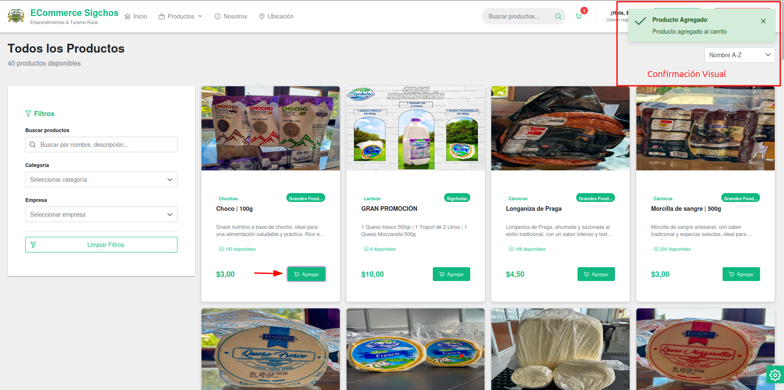{#fig-agregar-carrito}

## Gestión del carrito

Una vez agregado todos los productos, se puede dar el click en el ícono del carrito donde se va a mostrar la página del carrito de compras del usuario con todos los productos seleccionados. Como se observa en la @fig-seleccion-carrito, el ícono se encuentra en la parte superior derecha:

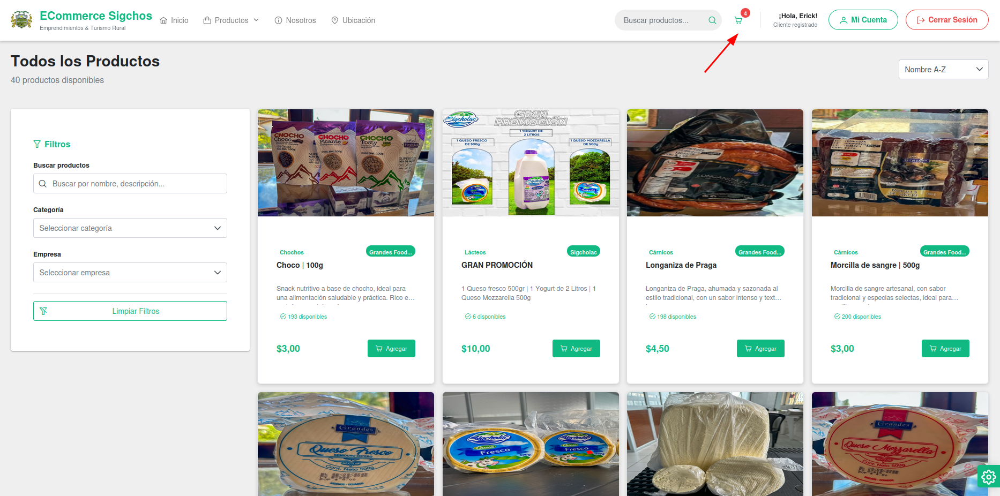{#fig-seleccion-carrito}

Una vez accedido a nuestor carrito podemos:

- Revisar todos los productos agregados al carrito.
- Verificar el resumen de costos (subtotal, impuestos, envío, total).
- Modificar cantidades, eliminar productos o vaciar carrito.
- Proceder al proceso de pago seguro.
- Continuar comprando agregando más productos.
- Vaciar el carrito.

\begin{infobox}[Resumen de Compra]
Verifique siempre el total del pedido antes de proceder al pago para asegurar que las cantidades y productos sean los deseados.
\end{infobox}

En la @fig-gestion-carrito se observa la interfaz de gestión del carrito:

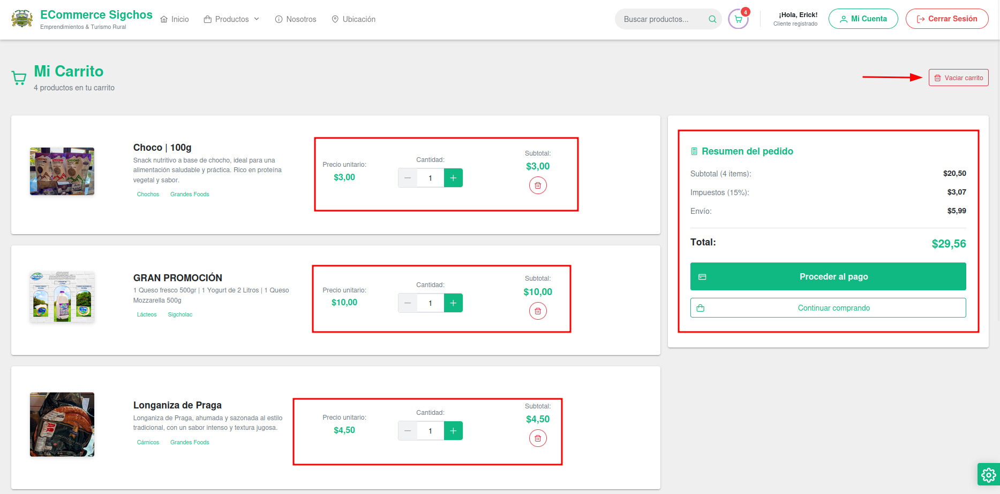{#fig-gestion-carrito}

## Proceso de pago (checkout)

### Fase 1: Datos de envío

Al momento de proceder al pago se debe proporcionar información personal y de envío para completar la compra. El sistema garantiza un proceso seguro y protegido para el manejo de datos sensibles.

1. **Sección: Información de Envío**

   **Datos de Envío**
   - **"Información Personal"**

    Campos obligatorios:
   - **Nombre***: Campo para ingresar el nombre (ejemplo: "Erick").
   - **Apellido***: Campo para ingresar el apellido (ejemplo: "Moreira").
   - **Cédula***: Campo para ingresar el número de identificación (ejemplo: "1315110534")
   - **Teléfono***: Campo para ingresar el número de contacto (ejemplo: "0972911176")

2. **Sección: Información de Contacto**
   - **Email***: Campo para ingresar el correo electrónico (ejemplo: "erickmoreira@gmail.com")
   - **Dirección de Envío***: Campo para ingresar la dirección completa.

3. **Aviso de seguridad**
   - **"Datos Seguros"**: Mensaje que garantiza: "Tus datos serán guardados de forma segura y encriptada para futuras compras"

\begin{importantbox}[Protección de Datos]
Toda la información personal ingresada durante el proceso de envío se maneja bajo protocolos de seguridad TLS para proteger su privacidad.
\end{importantbox}

Como se observa en la @fig-datos-envio, se requiere completar el formulario de envío:

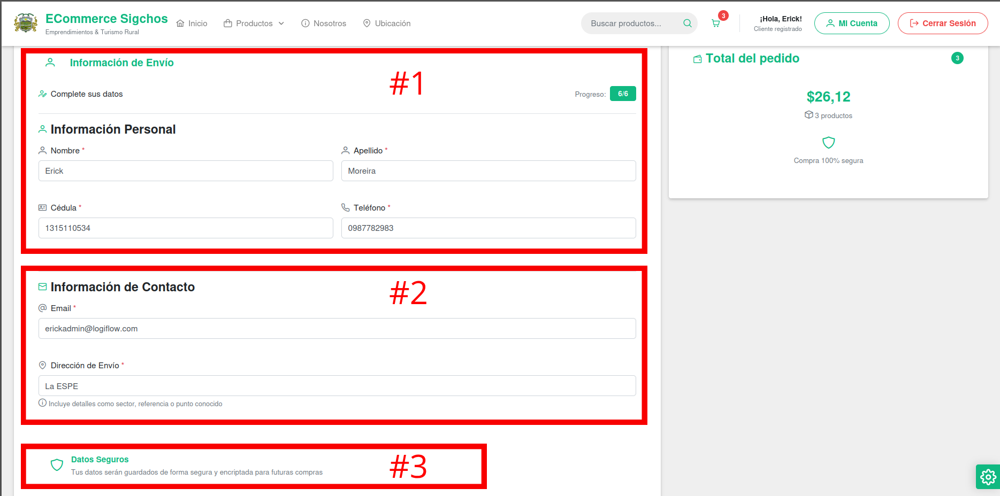{#fig-datos-envio}

4. **Confirmación y navegación**
   - **"Continuar a revisión"**: Si el formulario fue completado de manera exitosa se muestra el mensaje de validación exitosa.
   - **Botón "Volver al carrito"**: Para regresar y revisar o modificar los productos.

En la @fig-datos-envio-cont se observa el botón de confirmación una vez validados los datos:

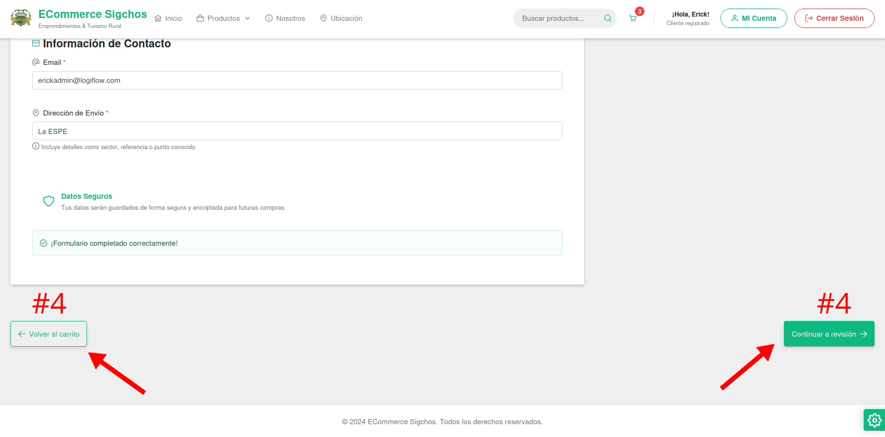{#fig-datos-envio-cont}

### Fase 2: Revisión

Se puede revisar y confirmar todos los detalles de su compra antes de proceder al pago. Es el paso final de verificación donde se muestran los datos del envío, los productos, cantidades y el desglose completo de costos. Como se observa en la @fig-revision-pedido, se presenta el resumen final:

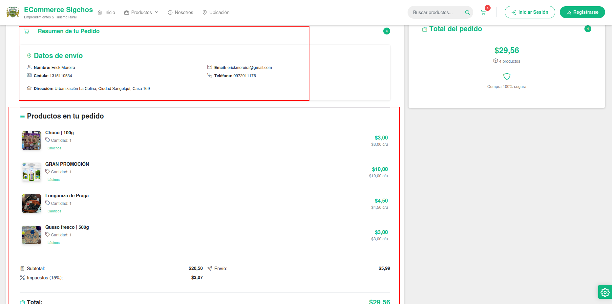{#fig-revision-pedido}

1. **Botones de acción final**
    - **"Continuar al Pago"**: Botón principal para avanzar al proceso de pago real.
    - **"Atrás"**: Botón para volver atrás y modificar algo.

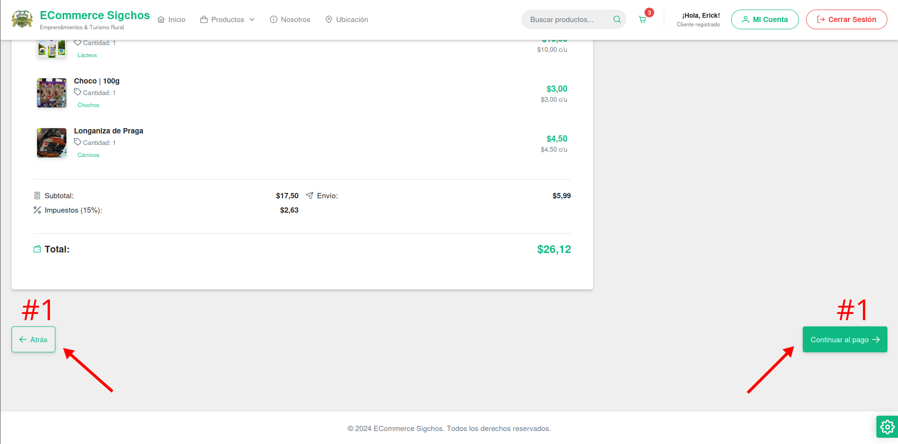{#fig-revision-cont}

### Fase 3: Procesamiento de pago

El sistema procesa de forma segura el pago del usuario. Durante esta etapa, se realizan validaciones, conexiones con pasarelas de pago y confirmación de la transacción en tiempo real. En la @fig-procesando-pago se observa el estado del procesamiento:

1. **Estado del procesamiento**
   - **"Procesando pago..."**: Primero se muestra el indicador principal de que la transacción está en curso

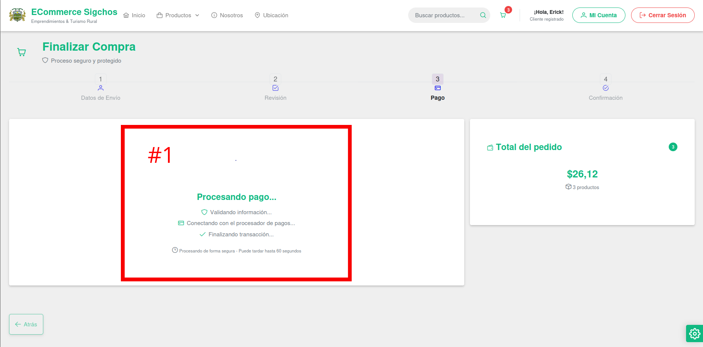{#fig-procesando-pago}

   - **Sub-etapas mostradas**:

   - **Validando información**: Verificación de datos del usuario y del pedido.
   - **Conectando con el procesador de pagos**: Establecimiento de conexión segura con la pasarela.
   - **Finalizando transacción**: Procesamiento final y confirmación.

Como se observa en la @fig-procesando-pago-cont, el sistema muestra el avance del procesamiento del pago:

2. **Resumen del pedido (lateral derecho)**
    - **"Total del pedido"**: Por ejemplo: $29.56
    - **Cantidad de productos**: Por ejemplo: 4 productos

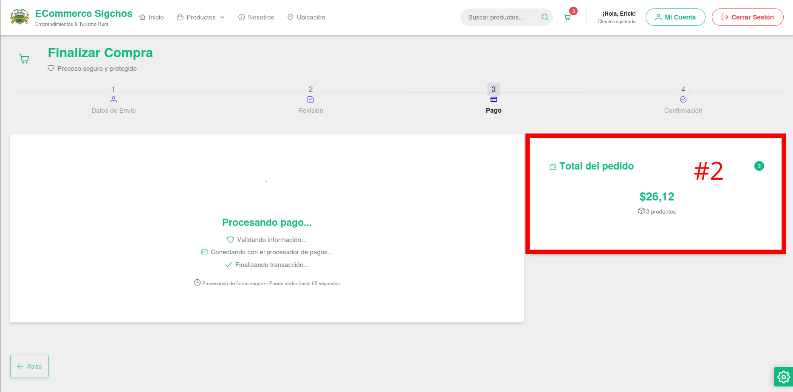{#fig-procesando-pago-cont}

### Fase 4: Confirmación

Se muestra la confirmación exitosa del pago y se proporciona al usuario su número de orden y el aviso de que recibirá un correo de confirmación. En la @fig-confirmacion-pedido se observa el mensaje de éxito final:

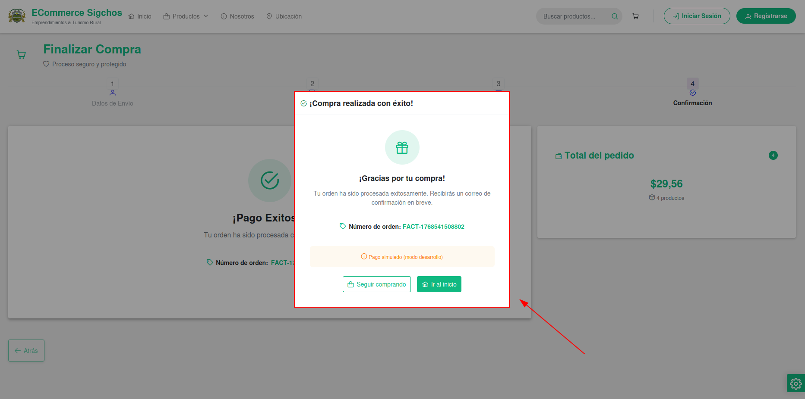{#fig-confirmacion-pedido}

## Pasarela de Pagos Payphone

Para garantizar la seguridad en las transacciones con tarjeta de crédito, débito o mediante la app móvil, la plataforma integra la pasarela de pagos oficial de **Payphone**. Al ser una integración directa, ningún dato bancario sensible pasa por nuestros servidores.

### Selección del Método de Pago

Durante el proceso de revisión de compra (Fase 2), el sistema mostrará las opciones de pago disponibles. Al seleccionar **Payphone**, la opción se resaltará con un recuadro de color naranja, indicando que el pago será procesado por esta vía segura.

Como se observa en la @fig-payphone-selector, el usuario selecciona Payphone entre las alternativas:

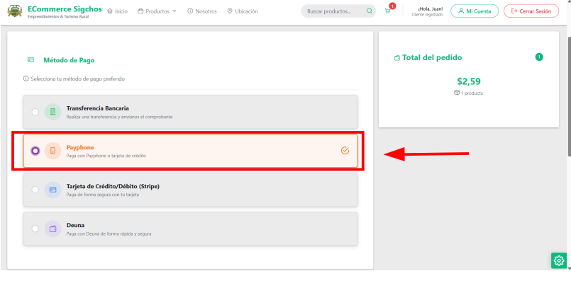{#fig-payphone-selector}

### Renderizado del Botón de Pago

Una vez seleccionado el método, el sistema cargará de forma automática el botón oficial de Payphone, el cual ofrece las alternativas de pagar con tarjeta (Visa, Mastercard) o directamente a través de la aplicación móvil de Payphone (App).

En la @fig-payphone-boton se visualiza el botón interactivo incrustado en el carrito:

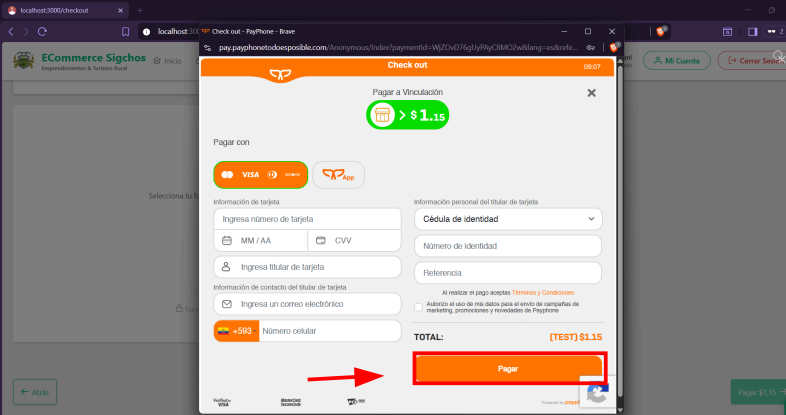{#fig-payphone-boton}

### Interfaz Segura de Payphone (Cajita de Pagos)

Al pulsar el botón de pago, se desplegará una ventana segura (modal) proporcionada directamente por Payphone. En esta ventana emergente, el cliente podrá ingresar de manera totalmente confidencial los datos de su tarjeta o su número de celular para usar la app móvil.

En la @fig-payphone-interfaz se observa el entorno seguro donde se completan los datos financieros:

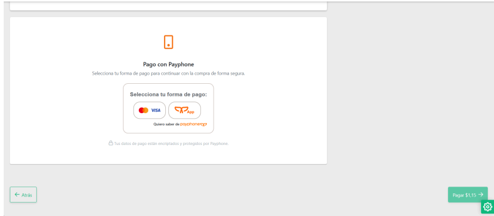{#fig-payphone-interfaz}

### Estados de Confirmación de Pago

Una vez que el cliente autoriza y envía el pago en la pasarela, será redirigido automáticamente a nuestra tienda, donde se evaluará la transacción en tiempo real:

1. **Estado "Verificando":**
   Mientras el sistema se conecta con los servidores de Payphone para confirmar la validez de los fondos, se mostrará una pantalla de carga.

   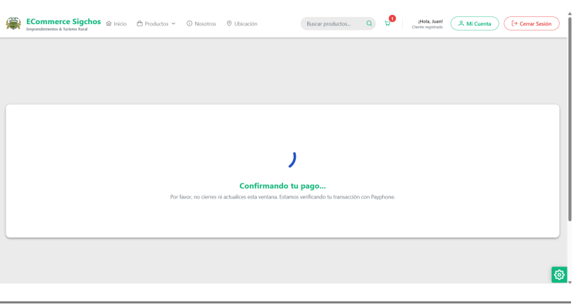{#fig-payphone-verificando}

2. **Pago Exitoso:**
   Si la transacción fue aprobada, se presentará el mensaje "¡Pago Exitoso!", incluyendo el número de transacción oficial generado por Payphone y el monto cobrado.

   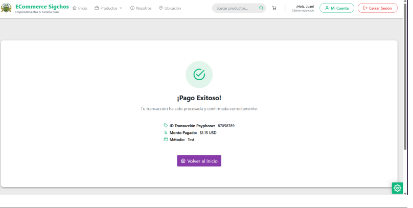{#fig-payphone-exitoso}

3. **Pago Cancelado:**
   Si el usuario cancela la operación o hay un problema con la tarjeta, el sistema registrará la notificación de "Pago Cancelado" sin realizar ningún cargo económico al cliente.

   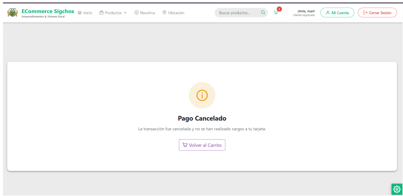{#fig-payphone-cancelado}

\begin{infobox}[Respaldo Automático]
Cuando un pago a través de Payphone es exitoso, el sistema registra automáticamente la venta como "COMPLETADA", descuenta el inventario e informa al emprendedor para el despacho del producto.
\end{infobox}

## Factura de la compra

Después de completar la compra, el cliente puede consultar la factura generada por el sistema. Esta factura sirve como comprobante de los productos comprados y del valor pagado.

- Ingresar al historial o detalle de la compra.
- Buscar la factura del pedido.
- Revisar los datos del cliente, productos, subtotal, IVA y total.
- Guardar o descargar el comprobante si lo necesita.

## Seguimiento del pedido

El cliente puede revisar cómo avanza su pedido desde que se confirma el pago hasta que llega a su destino. El estado del pedido se actualiza cuando el emprendedor cambia la etapa del proceso.

Estados que puede visualizar el cliente:

- **Pago aprobado:** el pago fue confirmado correctamente.
- **En preparación:** el emprendedor está preparando el pedido.
- **Listo para envío:** el pedido ya está listo para ser entregado.
- **En camino:** el pedido se encuentra en proceso de entrega.
- **Entregado:** el pedido llegó al cliente.

De esta manera, el cliente puede conocer todo el proceso de su pedido sin tener que comunicarse directamente con el emprendedor.

Estos son todos los pasos para realizar compras de manera exitosa y segura dentro de la plataforma de Comercio Electrónico para los Emprendimientos del Cantón Sigchos.
