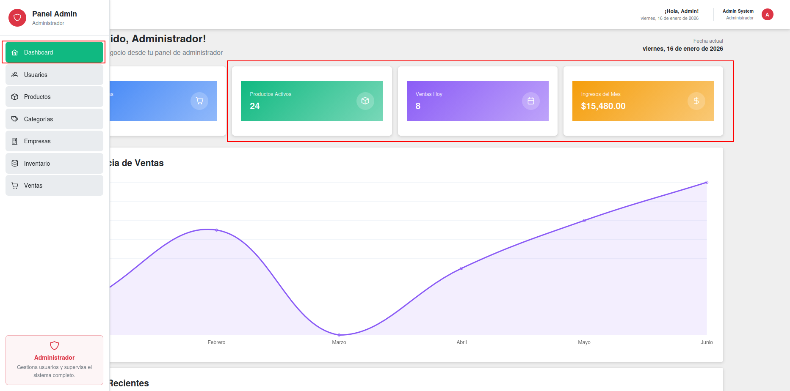
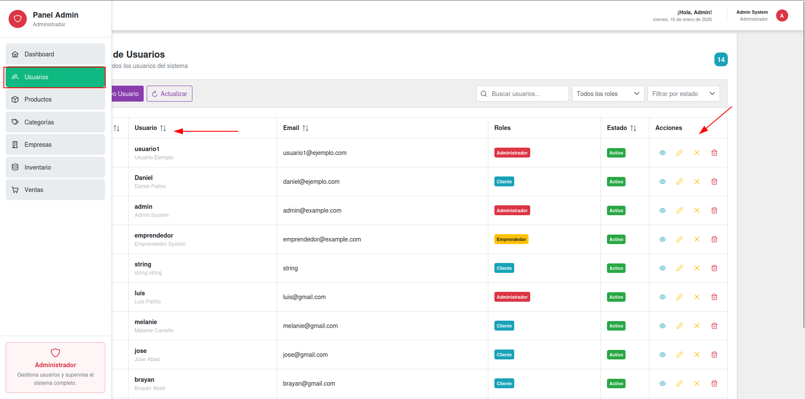
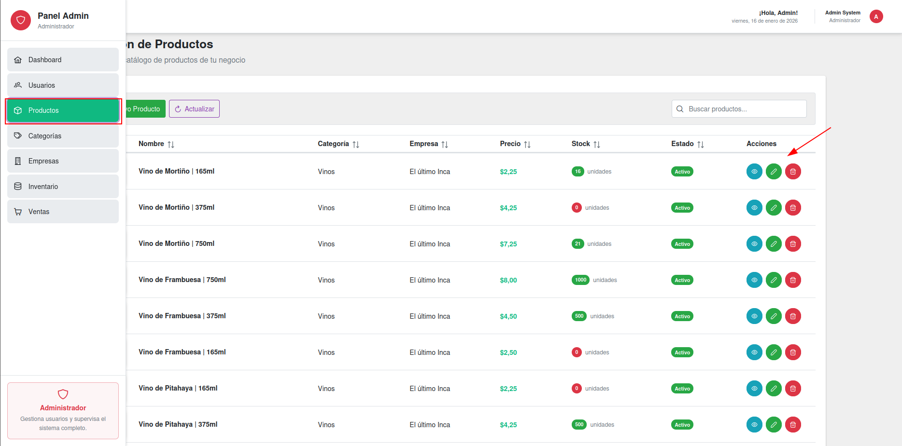
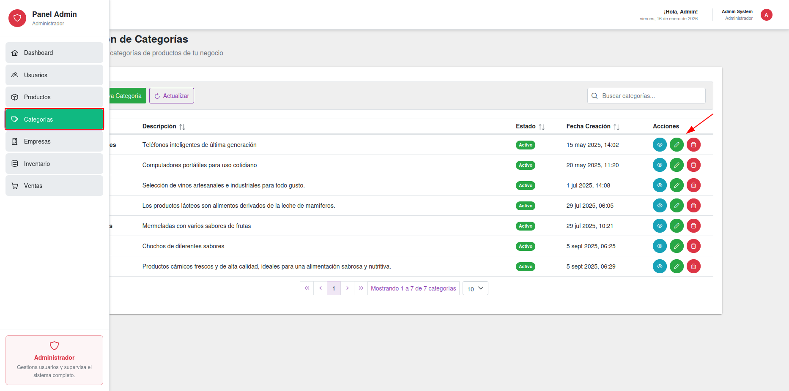
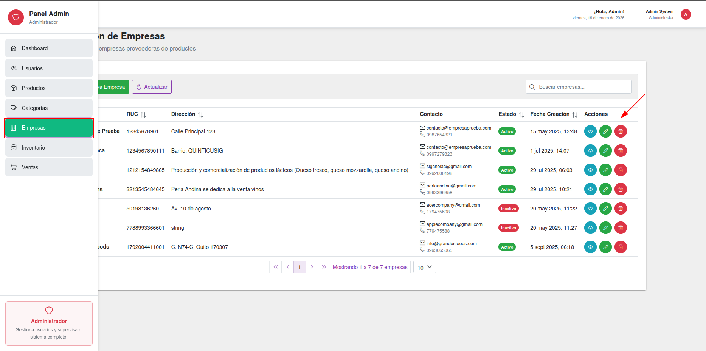
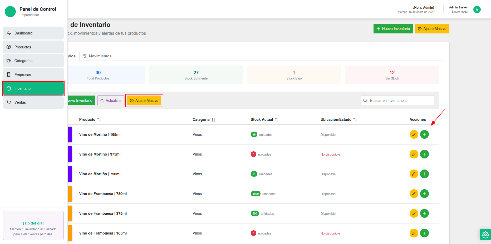
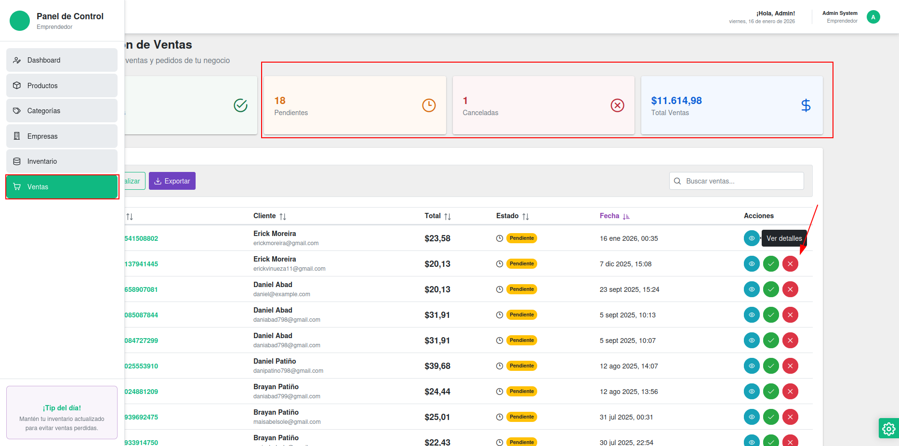
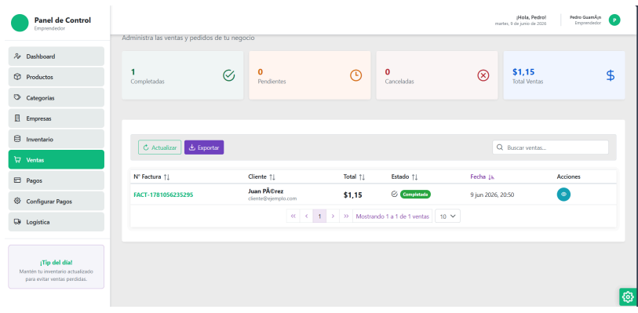

# Sección Administración para Emprendedores

## Panel de Administración

Esta es la interfaz principal del panel de administración de **ECommerce Sigchos**, diseñada para que el administrador del sistema gestione todos los aspectos de la plataforma, desde productos y categorías hasta ventas e inventario, incluido un dashboard para observar métricas.

1. **Menú principal de gestión (lado izquierdo)**

   Secciones disponibles para administrar:
   - **Dashboard**: Visualización de métricas y estadísticas.

    **Métricas y estadísticas principales del Dashboard**

    Tres tarjetas con KPIs clave:

    **a. Productos Activos**
    - **24**: Número de productos en curso.

    **b. Ventas Hoy**
    - **8**: Número de ventas realizadas en el día actual.

    **c. Total de Ingresos**
    - **$15,480.00**: Suma total de ingresos generados durante el mes.

\begin{infobox}[Métricas en Tiempo Real]
El dashboard permite al administrador tomar decisiones basadas en datos reales sobre el desempeño comercial de los emprendimientos.
\end{infobox}

En la @fig-admin-panel se observa el panel de administración principal con sus métricas clave:

{#fig-admin-panel}

   - **Usuarios**: Gestión de usuarios registrados en el Ecommerce, permitiendo acciones como agregar un nuevo usuario, ver detalles, editar sus datos, desactivarlo o eliminarlo.

\begin{importantbox}[Privacidad de Datos]
El administrador debe manejar con estricta confidencialidad los datos personales de los usuarios registrados, cumpliendo con la normativa vigente.
\end{importantbox}

Como se observa en la @fig-admin-usuarios, el módulo de usuarios permite una gestión completa de cuentas:

{#fig-admin-usuarios}

   - **Productos**: Gestión del catálogo de productos completo en el Ecommerce, permitiendo acciones como agregar un nuevo producto, ver detalles, editar o eliminarlo.

En la @fig-admin-productos se observa la lista de productos disponibles para gestión administrativa:

{#fig-admin-productos}

   - **Categorías**: Administración de categorías de productos del Ecommerce, permitiendo acciones como agregar una nueva categoría, ver detalles, editar o eliminarla.

Como se observa en la @fig-admin-categorias, el sistema permite organizar los productos por categorías lógicas:

{#fig-admin-categorias}

   - **Empresas**: Gestión de emprendedores/empresas asociadas, permitiendo acciones como agregar una nueva empresa, ver detalles, editar o eliminarla.

En la @fig-admin-empresas se observa el módulo de registro de empresas y emprendedores:

{#fig-admin-empresas}

   - **Inventario**: Control de stock y disponibilidad, permitiendo acciones como editar el inventario o realizar un ajuste rápido, además el administrador tiene la opción extra de realizar un ajuste masivo.

\begin{importantbox}[Control de Inventario]
Un ajuste masivo de inventario es una acción irreversible. Se recomienda realizar un respaldo de los datos antes de proceder con cambios a gran escala.
\end{importantbox}

Como se observa en la @fig-admin-inventario, el módulo de inventarios facilita el control de existencias:

{#fig-admin-inventario}

   - **Ventas**: Visualización y gestión de pedidos para realizar seguimiento de los pedidos completados, cancelados, etc. Además permite acciones como como ver detalles, completar la venta y cancelarla.

En la @fig-admin-ventas se observa el registro histórico y actual de todas las transacciones realizadas:

{#fig-admin-ventas}

Adicionalmente, si la compra fue pagada usando la pasarela **Payphone**, el sistema asociará automáticamente el "ID de Transacción" generado por Payphone y marcará la venta como "Completada", notificando en el panel del emprendedor para su inmediato despacho.

Como se observa en la @fig-admin-venta-payphone, la venta respaldada por Payphone aparece de manera automática en el módulo:

{#fig-admin-venta-payphone}

### Función:
En resumen, este panel permite al administrador:

- Acceder a todas las herramientas de gestión de la plataforma.
- Monitorear el desempeño comercial en tiempo real.
- Gestionar el catálogo completo de productos.
- Administrar empresas y categorías asociadas.
- Controlar inventarios y disponibilidad de productos.
- Supervisar y procesar ventas y pedidos.
- Ver métricas clave de desempeño del negocio.
- Verificar el stock antes de publicar o promocionar productos.

## Gestión de productos

- Seleccionar la opción "Productos".
- Usar "Nuevo producto" para registrar un artículo.
- Completar datos como nombre, categoría, empresa, precio y stock.
- Editar un producto cuando sea necesario.
- Mantener actualizado el stock para evitar ventas de productos no disponibles.

\begin{infobox}[Control de Catálogo]
Mantener el catálogo y los niveles de stock actualizados es fundamental para brindar una buena experiencia de compra y evitar reclamos por productos agotados.
\end{infobox}

## Revisión de ventas y cobros

En el apartado de ventas, el emprendedor puede revisar las compras realizadas por los clientes.

- Ingresar al menú "Ventas".
- Revisar la fecha, cliente, número de transacción, teléfono y monto.
- Usar filtros por fecha o estado para buscar ventas específicas.
- Entrar al detalle de una venta cuando se necesite revisar más información.

## Actualización de la logística del pedido

La logística del pedido la actualiza el emprendedor. Cada vez que el emprendedor cambia el estado, el cliente puede ver el avance de su pedido desde su cuenta.

El proceso recomendado es el siguiente:

- Verificar que el pago esté aprobado.
- Cambiar el estado a "En preparación" cuando empiece a preparar el pedido.
- Cambiar el estado a "Listo para envío" cuando el pedido esté empacado.
- Cambiar el estado a "En camino" cuando el pedido salga para entrega.
- Cambiar el estado a "Entregado" cuando el cliente reciba el pedido.

\begin{importantbox}[Transparencia Logística]
Es vital actualizar los estados en el orden correcto. Esto garantiza que el cliente tenga trazabilidad completa del recorrido de su pedido y genera confianza en el emprendedor.
\end{importantbox}

## Recomendaciones para el emprendedor

- Mantener actualizados los productos y precios.
- Revisar las ventas todos los días.
- Actualizar los estados logísticos apenas cambie la etapa del pedido.
- Usar descripciones claras para que el cliente entienda mejor cada producto.
- Verificar el stock antes de publicar o promocionar productos.
